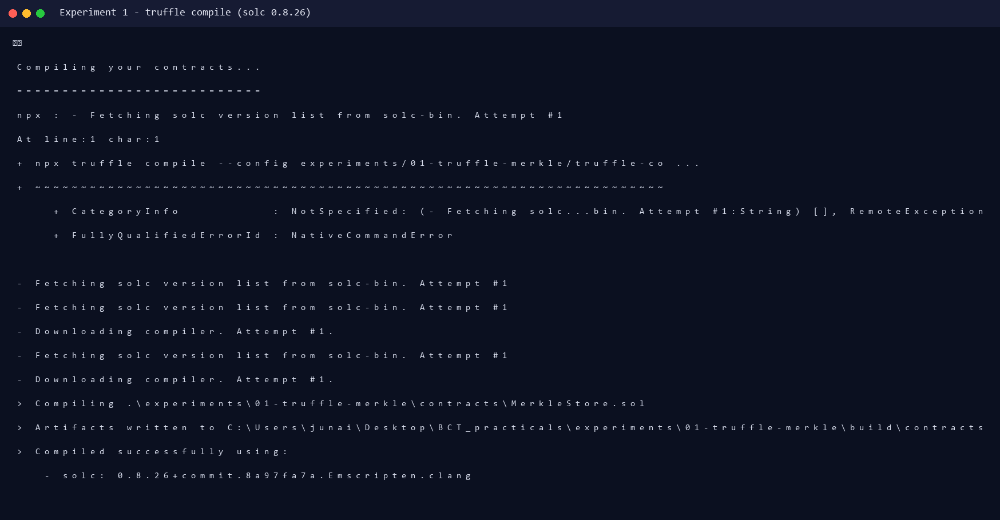
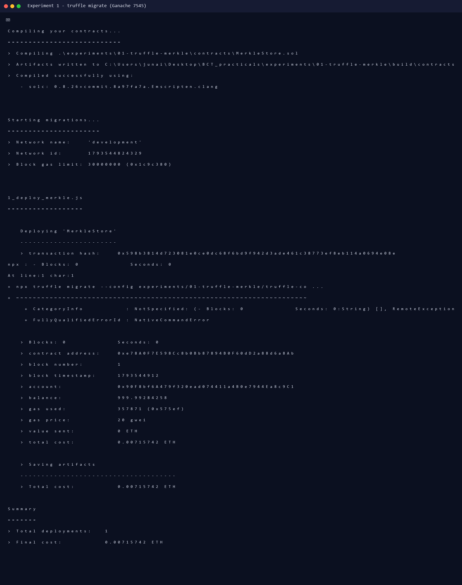
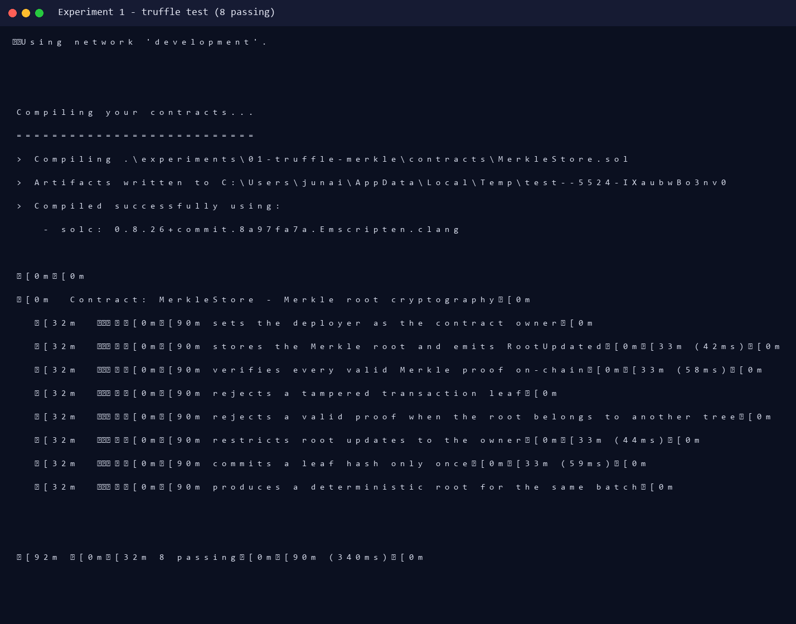
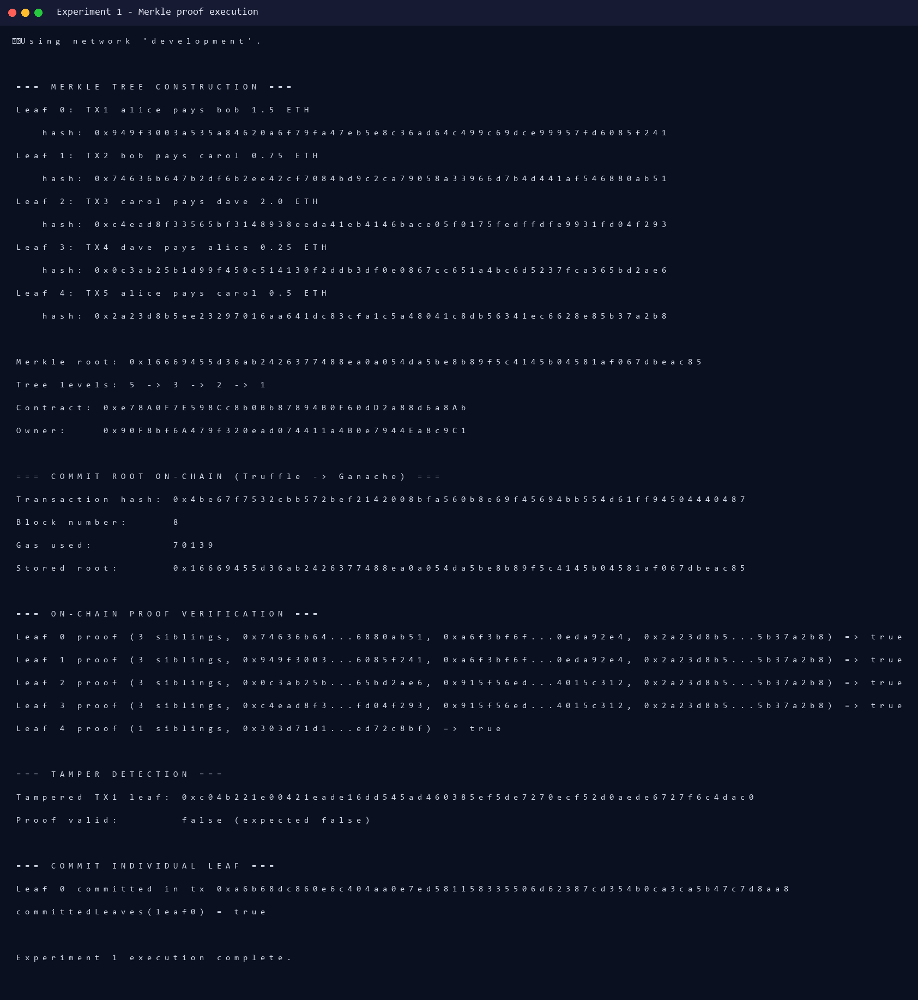
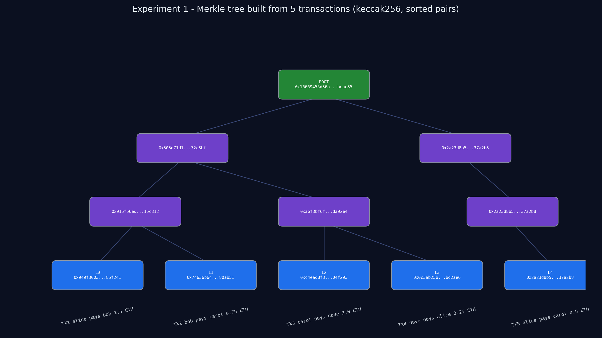

# Experiment 1 — Local Blockchain with Truffle + Merkle Root Cryptography

**Aim:** To study and implement a local blockchain using Truffle with integration of cryptography in blockchain using a Merkle root tree hash.

**Lab Outcome:** LO 1 — Develop and test a smart contract on a local blockchain.

---

## 1. Theory

A blockchain stores transactions in blocks. Instead of storing every transaction hash individually in a block header, blockchains such as Bitcoin store a single **Merkle root** — a cryptographic commitment to all transactions in the block. A Merkle tree is built by hashing transaction data into leaves and repeatedly hashing pairs of nodes until one root remains.

Properties demonstrated by this experiment:

- **Integrity:** changing any single transaction changes its leaf hash and therefore the root.
- **Compact proofs:** membership of a transaction can be proved using only `O(log n)` sibling hashes instead of the full transaction list.
- **On-chain verification:** the root is stored on-chain once, while proofs are verified by a smart contract.
- **Immutability:** a committed root cannot be changed without a new owner-signed transaction.

This practical uses **Truffle** (development framework), **Ganache** (local Ethereum blockchain), **Solidity 0.8.26** (smart contract), and **keccak256** (Ethereum's hash function).

---

## 2. Project Structure

```
experiments/01-truffle-merkle/
├── contracts/MerkleStore.sol      # stores root + verifies proofs
├── lib/merkle.js                  # off-chain Merkle tree (keccak256)
├── migrations/1_deploy_merkle.js  # Truffle deployment script
├── scripts/merkle_demo.js         # end-to-end demo (truffle exec)
├── scripts/build_tree_json.js     # exports the built tree for diagrams
├── test/merkle.test.js            # 8 Truffle tests
├── truffle-config.js              # network 127.0.0.1:7545
└── output/                        # real logs + screenshots from the run
```

### Merkle hashing rule

```text
leaf          = keccak256(utf8(transaction))
internal node = keccak256(min(a,b) || max(a,b))     // sorted pairs
root          = top of the tree
```

Sorted-pair hashing means a proof does not need left/right direction flags; the contract re-sorts each pair before hashing.

---

## 3. Smart Contract (core)

`contracts/MerkleStore.sol`:

```solidity
function setMerkleRoot(bytes32 _root, uint256 _leafCount) external onlyOwner {
    emit RootUpdated(merkleRoot, _root, _leafCount);
    merkleRoot = _root;
    leafCount = _leafCount;
}

function verify(bytes32[] calldata proof, bytes32 leaf) external view returns (bool) {
    return _verify(merkleRoot, proof, leaf);
}

function _verify(bytes32 root, bytes32[] calldata proof, bytes32 leaf)
    internal pure returns (bool)
{
    bytes32 computed = leaf;
    for (uint256 i = 0; i < proof.length; i++) {
        bytes32 sibling = proof[i];
        computed = computed <= sibling
            ? keccak256(abi.encodePacked(computed, sibling))
            : keccak256(abi.encodePacked(sibling, computed));
    }
    return computed == root;
}
```

The contract also exposes `verifyWithRoot`, `commitLeaf` (one-time leaf commitment) and an `onlyOwner` guard on state-changing functions.

---

## 4. Execution

### 4.1 Start the local blockchain

```powershell
npx ganache --port 7545 --chain.chainId 1337 --wallet.totalAccounts 10 `
  --wallet.defaultBalance 1000 --deterministic
```

Real Ganache accounts used by the run (deterministic mnemonic):

```text
(0) 0x90F8bf6A479f320ead074411a4B0e7944Ea8c9C1 (1000 ETH)
(1) 0xFFcf8FDEE72ac11b5c542428B35EEF5769C409f0 (1000 ETH)
...
Mnemonic: myth like bonus scare over problem client lizard pioneer submit female collect
RPC: 127.0.0.1:7545
```

### 4.2 Compile

```powershell
npx truffle compile --config experiments/01-truffle-merkle/truffle-config.js
```

Real output:

```text
> Compiling .\experiments\01-truffle-merkle\contracts\MerkleStore.sol
> Artifacts written to ...\experiments\01-truffle-merkle\build\contracts
> Compiled successfully using:
   - solc: 0.8.26+commit.8a97fa7a.Emscripten.clang
```

### 4.3 Deploy (migrate)

```powershell
npx truffle migrate --config experiments/01-truffle-merkle/truffle-config.js `
  --network development --reset
```

Real output:

```text
Deploying 'MerkleStore'
   > transaction hash:    0x598b3814d723081e0ce0dc68f6bd9f942d3ade461c38773ef8eb114a0694e08e
   > contract address:    0xe78A0F7E598Cc8b0Bb87894B0F60dD2a88d6a8Ab
   > block number:        1
   > account:             0x90F8bf6A479f320ead074411a4B0e7944Ea8c9C1
   > gas used:            357871
   > total cost:          0.00715742 ETH
```

### 4.4 Run tests

```powershell
npx truffle test --config experiments/01-truffle-merkle/truffle-config.js `
  --network development
```

Real output:

```text
Contract: MerkleStore - Merkle root cryptography
  ✔ sets the deployer as the contract owner
  ✔ stores the Merkle root and emits RootUpdated (42ms)
  ✔ verifies every valid Merkle proof on-chain (58ms)
  ✔ rejects a tampered transaction leaf
  ✔ rejects a valid proof when the root belongs to another tree
  ✔ restricts root updates to the owner (44ms)
  ✔ commits a leaf hash only once (59ms)
  ✔ produces a deterministic root for the same batch
8 passing (340ms)
```

### 4.5 End-to-end demo

```powershell
npx truffle exec --config experiments/01-truffle-merkle/truffle-config.js `
  experiments/01-truffle-merkle/scripts/merkle_demo.js --network development
```

**Input transactions (5):**

```text
TX1 alice pays bob 1.5 ETH
TX2 bob pays carol 0.75 ETH
TX3 carol pays dave 2.0 ETH
TX4 dave pays alice 0.25 ETH
TX5 alice pays carol 0.5 ETH
```

**Real output (abridged):**

```text
Merkle root: 0x16669455d36ab2426377488ea0a054da5be8b89f5c4145b04581af067dbeac85
Tree levels: 5 -> 3 -> 2 -> 1
Contract:    0xe78A0F7E598Cc8b0Bb87894B0F60dD2a88d6a8Ab

Transaction hash: 0x4be67f7532cbb572bef2142008bfa560b8e69f45694bb554d61ff94504440487
Block number:     8
Gas used:         70139
Stored root:      0x16669455d36ab2426377488ea0a054da5be8b89f5c4145b04581af067dbeac85

Leaf 0 proof (3 siblings, 0x74636b64...6880ab51, 0xa6f3bf6f...0eda92e4, 0x2a23d8b5...5b37a2b8) => true
Leaf 1 proof (3 siblings, 0x949f3003...6085f241, 0xa6f3bf6f...0eda92e4, 0x2a23d8b5...5b37a2b8) => true
Leaf 2 proof (3 siblings, 0x0c3ab25b...65bd2ae6, 0x915f56ed...4015c312, 0x2a23d8b5...5b37a2b8) => true
Leaf 3 proof (3 siblings, 0xc4ead8f3...fd04f293, 0x915f56ed...4015c312, 0x2a23d8b5...5b37a2b8) => true
Leaf 4 proof (1 siblings, 0x303d71d1...ed72c8bf) => true

Tampered TX1 leaf: 0xc04b221e00421eade16dd545ad460385ef5de7270ecf52d0aede6727f6c4dac0
Proof valid:       false (expected false)

Leaf 0 committed in tx 0xa6b68dc860e6c404aa0e7ed581158335506d62387cd354b0ca3ca5b47c7d8aa8
committedLeaves(leaf0) = true
```

---

## 5. Screenshots (actual run)

| Screenshot | Description |
|---|---|
|  | `truffle compile` with solc 0.8.26 |
|  | `truffle migrate` deploying to Ganache |
|  | 8/8 Truffle tests passing |
|  | Merkle root commit, proofs, tamper detection |
|  | Merkle tree built from the 5 real transactions |

---

## 6. Result

The Merkle tree was built from five transactions, its root was committed to a contract on a real local Ganache blockchain, and all five membership proofs verified on-chain. A tampered leaf produced `false`, demonstrating that the cryptographic commitment detects any change. The contract also enforced owner-only root updates and one-time leaf commitments.

**Conclusion:** Thus, a local blockchain was successfully created using Truffle, and cryptography in the form of a Merkle root tree hash was integrated and verified on-chain.
