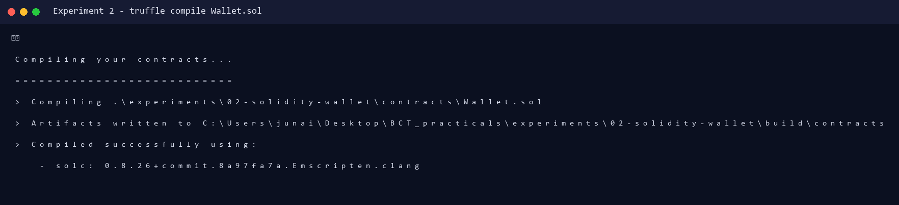
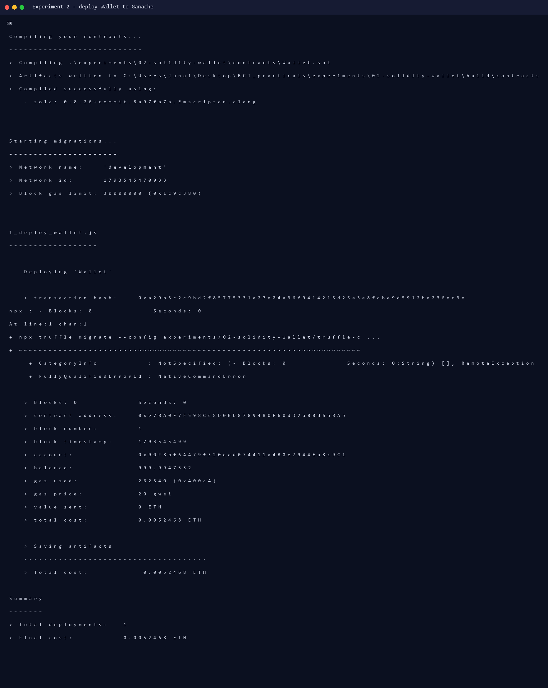
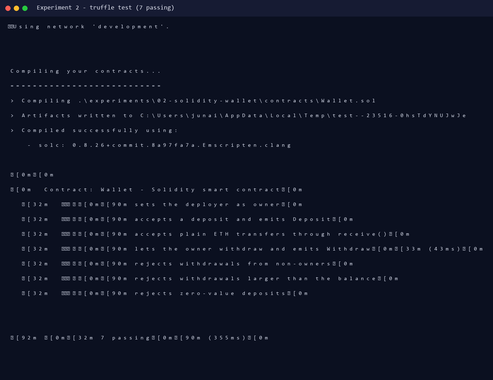
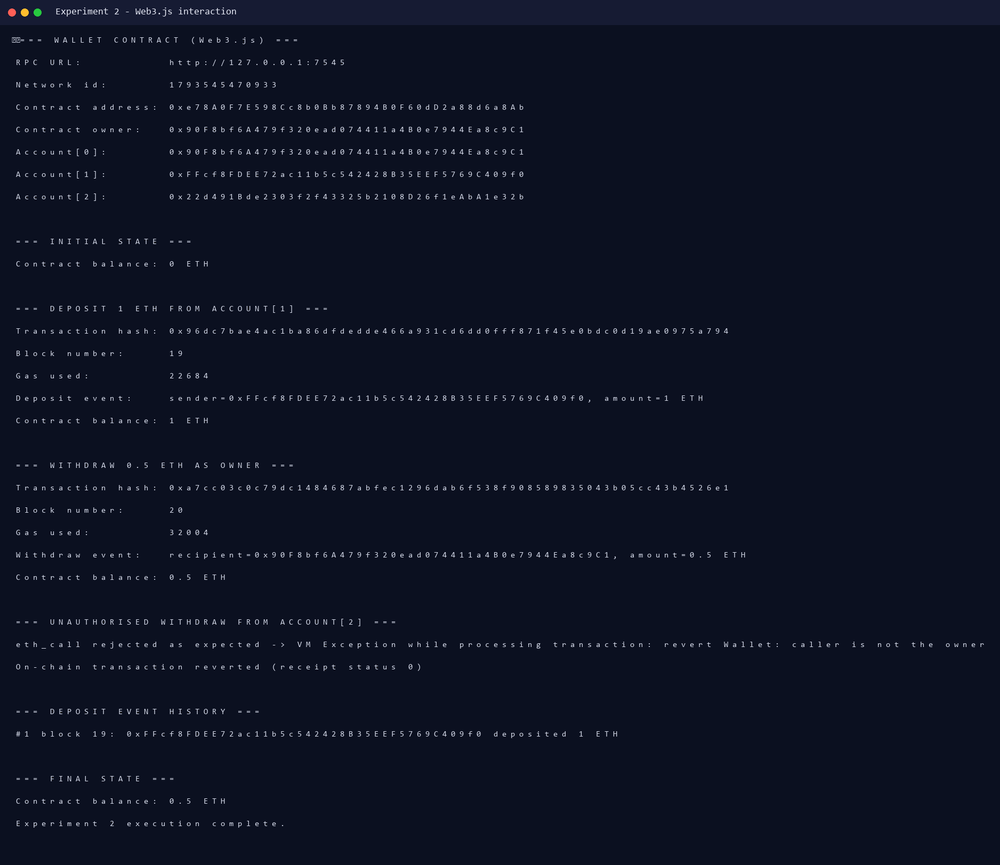

# Experiment 2 — Smart Contracts with Solidity + JavaScript (Web3.js)

**Aim:** To study and implement smart contracts using the Solidity programming language and interact with them using JavaScript.

**Lab Outcome:** LO 1 — Develop and test a smart contract on a local blockchain.

---

## 1. Theory

A **smart contract** is a program deployed to a blockchain. Its bytecode is immutable after deployment and its state transitions are validated by every node. Solidity is the most widely used language for writing Ethereum smart contracts; it is statically typed and supports inheritance, modifiers, events and custom data types.

This practical implements a **Wallet** contract that:

- stores the deployer as `owner`,
- accepts ETH deposits (`payable`),
- allows only the owner to withdraw,
- emits `Deposit` and `Withdraw` events,
- exposes a read-only `getBalance()`.

The deployed contract is then driven from JavaScript using **Web3.js**, which sends signed transactions to the local **Ganache** blockchain and reads contract state.

---

## 2. Project Structure

```
experiments/02-solidity-wallet/
├── contracts/Wallet.sol
├── migrations/1_deploy_wallet.js
├── scripts/interact.js          # Web3.js client
├── test/wallet.test.js          # 7 Truffle tests
├── truffle-config.js
└── output/                      # real logs + screenshots
```

---

## 3. Smart Contract

```solidity
// SPDX-License-Identifier: MIT
pragma solidity ^0.8.20;

contract Wallet {
    address public owner;

    event Deposit(address indexed sender, uint256 amount);
    event Withdraw(address indexed recipient, uint256 amount);

    modifier onlyOwner() {
        require(msg.sender == owner, "Wallet: caller is not the owner");
        _;
    }

    constructor() { owner = msg.sender; }

    function deposit() external payable {
        require(msg.value > 0, "Wallet: deposit must be greater than zero");
        emit Deposit(msg.sender, msg.value);
    }

    function withdraw(uint256 amount) external onlyOwner {
        require(address(this).balance >= amount, "Wallet: insufficient balance");
        (bool success, ) = payable(msg.sender).call{value: amount}("");
        require(success, "Wallet: transfer failed");
        emit Withdraw(msg.sender, amount);
    }

    function getBalance() external view returns (uint256) {
        return address(this).balance;
    }

    receive() external payable {
        emit Deposit(msg.sender, msg.value);
    }
}
```

`call{value: ...}` is used instead of the deprecated `transfer()` because `transfer()` forwards only 2300 gas and can break recipients with non-trivial fallback logic.

---

## 4. Execution

### 4.1 Start Ganache (local blockchain)

```powershell
npx ganache --port 7545 --chain.chainId 1337 --wallet.totalAccounts 10 `
  --wallet.defaultBalance 1000 --deterministic
```

### 4.2 Compile

```powershell
npx truffle compile --config experiments/02-solidity-wallet/truffle-config.js
```

```text
> Compiling .\experiments\02-solidity-wallet\contracts\Wallet.sol
> Artifacts written to ...\experiments\02-solidity-wallet\build\contracts
> Compiled successfully using:
   - solc: 0.8.26+commit.8a97fa7a.Emscripten.clang
```

### 4.3 Deploy

```powershell
npx truffle migrate --config experiments/02-solidity-wallet/truffle-config.js `
  --network development --reset
```

```text
Deploying 'Wallet'
   > transaction hash:    0xa29b3c2c9bd2f85775331a27e04a36f9414215d25a3e8fdbe9d5912be236ec3e
   > contract address:    0xe78A0F7E598Cc8b0Bb87894B0F60dD2a88d6a8Ab
   > block number:        1
   > account:             0x90F8bf6A479f320ead074411a4B0e7944Ea8c9C1
   > gas used:            262340
   > total cost:          0.0052468 ETH
```

### 4.4 Run tests

```powershell
npx truffle test --config experiments/02-solidity-wallet/truffle-config.js `
  --network development
```

```text
Contract: Wallet - Solidity smart contract
  ✔ sets the deployer as owner
  ✔ accepts a deposit and emits Deposit
  ✔ accepts plain ETH transfers through receive()
  ✔ lets the owner withdraw and emits Withdraw (43ms)
  ✔ rejects withdrawals from non-owners
  ✔ rejects withdrawals larger than the balance
  ✔ rejects zero-value deposits
7 passing (355ms)
```

### 4.5 Interact from JavaScript (Web3.js)

```powershell
node experiments/02-solidity-wallet/scripts/interact.js
```

**Input actions:** deposit `1 ETH` from account[1], withdraw `0.5 ETH` as owner, attempt a withdrawal from account[2].

**Real output:**

```text
=== WALLET CONTRACT (Web3.js) ===
RPC URL:          http://127.0.0.1:7545
Network id:       1793545470933
Contract address: 0xe78A0F7E598Cc8b0Bb87894B0F60dD2a88d6a8Ab
Contract owner:   0x90F8bf6A479f320ead074411a4B0e7944Ea8c9C1

=== INITIAL STATE ===
Contract balance: 0 ETH

=== DEPOSIT 1 ETH FROM ACCOUNT[1] ===
Transaction hash: 0x96dc7bae4ac1ba86dfdedde466a931cd6dd0fff871f45e0bdc0d19ae0975a794
Block number:     19
Gas used:         22684
Deposit event:    sender=0xFFcf8FDEE72ac11b5c542428B35EEF5769C409f0, amount=1 ETH
Contract balance: 1 ETH

=== WITHDRAW 0.5 ETH AS OWNER ===
Transaction hash: 0xa7cc03c0c79dc1484687abfec1296dab6f538f908589835043b05cc43b4526e1
Block number:     20
Gas used:         32004
Withdraw event:   recipient=0x90F8bf6A479f320ead074411a4B0e7944Ea8c9C1, amount=0.5 ETH
Contract balance: 0.5 ETH

=== UNAUTHORISED WITHDRAW FROM ACCOUNT[2] ===
eth_call rejected as expected -> VM Exception while processing transaction: revert Wallet: caller is not the owner
On-chain transaction reverted (receipt status 0)

=== DEPOSIT EVENT HISTORY ===
#1 block 19: 0xFFcf8FDEE72ac11b5c542428B35EEF5769C409f0 deposited 1 ETH

=== FINAL STATE ===
Contract balance: 0.5 ETH
```

---

## 5. Screenshots (actual run)

| Screenshot | Description |
|---|---|
|  | Compilation with solc 0.8.26 |
|  | Wallet deployment transaction |
|  | 7/7 Truffle tests passing |
|  | Deposit, withdraw and access-control revert via Web3.js |

---

## 6. Result

The `Wallet` contract compiled and deployed successfully on Ganache. A 1 ETH deposit increased the contract balance to 1 ETH, the owner withdrew 0.5 ETH, and the non-owner withdrawal was rejected by the EVM with `revert Wallet: caller is not the owner`. All 7 automated tests passed.

**Conclusion:** Thus, a Solidity smart contract was successfully implemented, deployed and interacted with using JavaScript and Web3.js.
