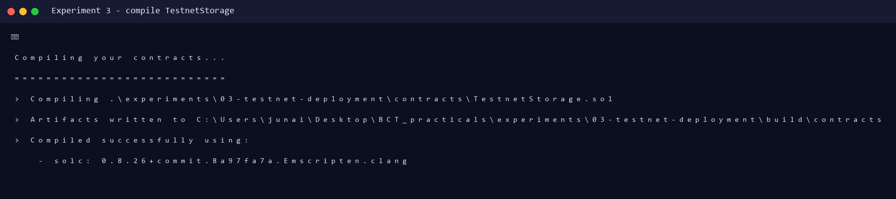
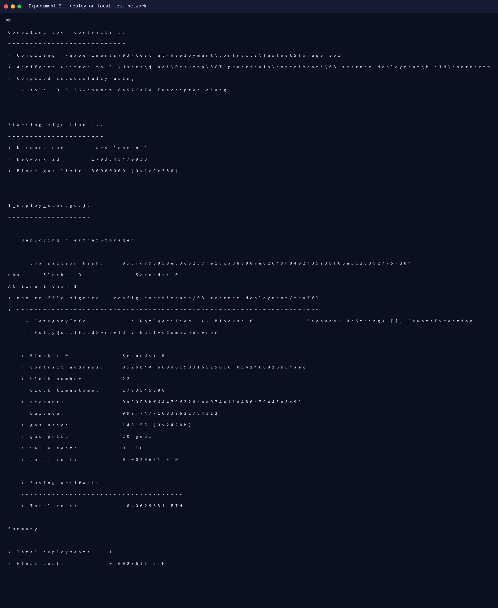
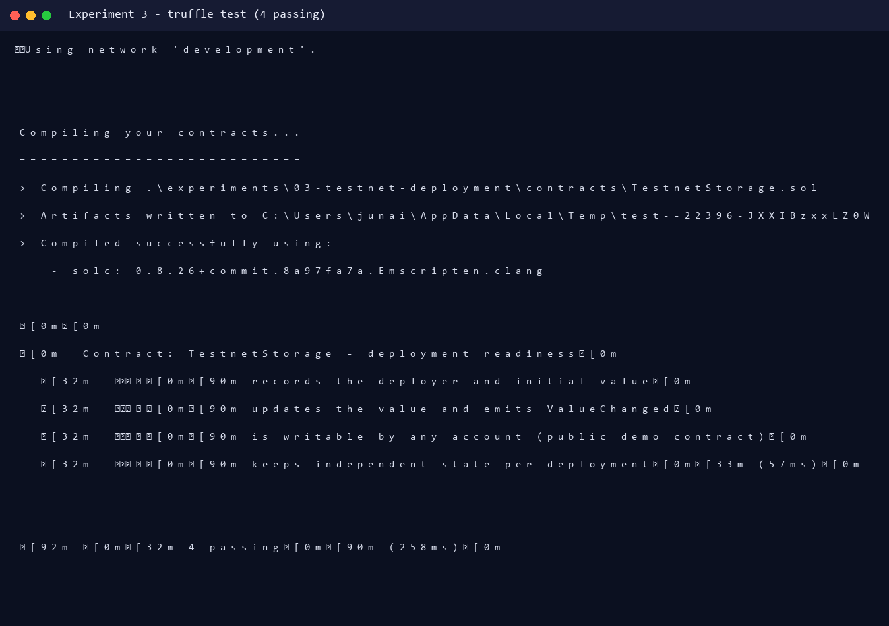
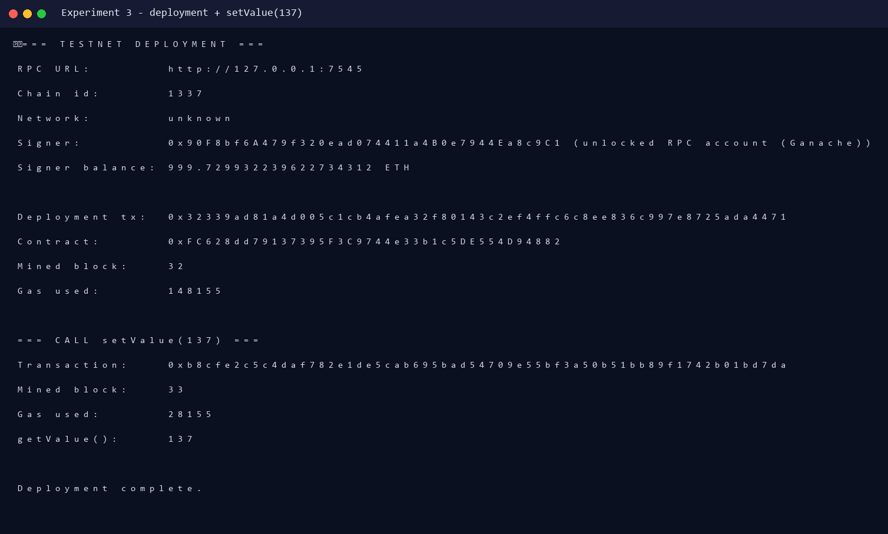
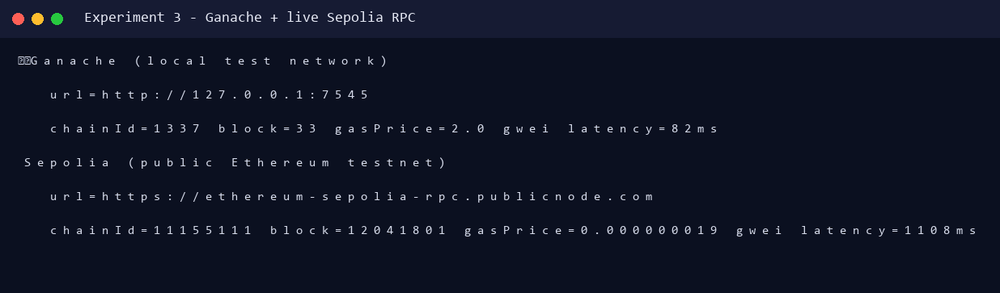
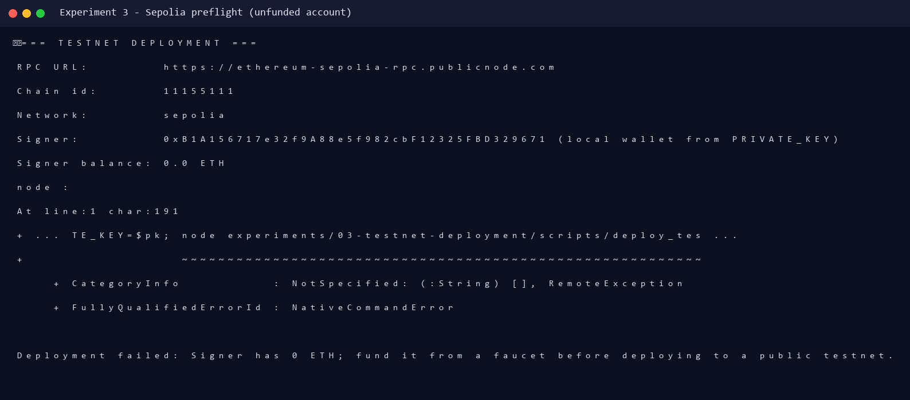

# Experiment 3 — Deployment and Publishing on an Ethereum Test Network

**Aim:** To study and implement the deployment and publishing of smart contracts on an Ethereum test network.

**Lab Outcome:** LO 2 — Develop and test a smart contract on Ethereum test networks.

---

## 1. Theory

Deploying to Ethereum mainnet costs real ETH and is irreversible. A **test network (testnet)** is a separate Ethereum chain that behaves like mainnet but uses worthless test ETH, so contracts can be compiled, deployed, exercised and verified safely.

| Network | Chain ID | Purpose |
|---|---|---|
| Sepolia | `11155111` | Current recommended public Ethereum testnet |
| Holesky | `17000` | Public validator/staking testnet |
| Ganache | `1337` | Private local test network used for fast iteration |

Deployment workflow:

1. Write and compile the contract (Solidity → ABI + bytecode).
2. Connect a wallet/provider to the chosen network.
3. Send a deployment transaction containing the bytecode and constructor arguments.
4. Record the contract address and deployment transaction hash.
5. Publish/verify the source code so users can inspect it (Etherscan/Blockscout).

---

## 2. Contract Used

`contracts/TestnetStorage.sol` is a small stateful contract: it stores a number, emits `ValueChanged`, and records the deployer.

```solidity
constructor(uint256 initialValue) {
    deployer = msg.sender;
    value = initialValue;
    emit ValueChanged(msg.sender, 0, initialValue);
}

function setValue(uint256 newValue) external {
    uint256 oldValue = value;
    value = newValue;
    emit ValueChanged(msg.sender, oldValue, newValue);
}

function getValue() external view returns (uint256) {
    return value;
}
```

---

## 3. Execution Status (honest record)

| Step | Status | Evidence |
|---|---|---|
| Compile with solc 0.8.26 | Executed | `output/compile.log` |
| Deploy on local test network (Ganache, chain 1337) | Executed | `output/deploy_local.log` |
| `setValue(137)` transaction | Executed | `output/deploy_local.log` |
| Live connection to Sepolia RPC (chain 11155111) | Executed | `output/network_check.log` |
| Sepolia deployment | Prepared + preflighted; **not executed** because no funded Sepolia account or API key exists in this environment | `output/sepolia_preflight.log` |

The Sepolia preflight is a real run against `https://ethereum-sepolia-rpc.publicnode.com`. It connected to chain `11155111`, derived the signer address, and correctly refused to deploy because the balance was `0.0 ETH`. This avoids pretending that a public deployment happened.

---

## 4. Commands and Real Output

### 4.1 Compile

```powershell
npx truffle compile --config experiments/03-testnet-deployment/truffle-config.js
```

```text
> Compiling .\experiments\03-testnet-deployment\contracts\TestnetStorage.sol
> Compiled successfully using:
   - solc: 0.8.26+commit.8a97fa7a.Emscripten.clang
```

### 4.2 Deploy on the local test network

```powershell
npx truffle migrate --config experiments/03-testnet-deployment/truffle-config.js `
  --network development --reset
```

```text
Deploying 'TestnetStorage'
   > transaction hash:    0x3fd79b859e53c32c7fe1dca88b887e6264948402f35a3bf0be3c2d392775fd84
   > contract address:    0x26b4AFb60d6C903165150C6F0AA14F8016bE4aec
   > block number:        22
   > gas used:            148155
   > total cost:          0.0029631 ETH
```

### 4.3 Tests

```powershell
npx truffle test --config experiments/03-testnet-deployment/truffle-config.js `
  --network development
```

```text
Contract: TestnetStorage - deployment readiness
  ✔ records the deployer and initial value
  ✔ updates the value and emits ValueChanged
  ✔ is writable by any account (public demo contract)
  ✔ keeps independent state per deployment (57ms)
4 passing (258ms)
```

### 4.4 Ethers.js deployment script (works on Ganache and Sepolia)

```powershell
node experiments/03-testnet-deployment/scripts/deploy_testnet.js
```

Real Ganache run:

```text
=== TESTNET DEPLOYMENT ===
RPC URL:        http://127.0.0.1:7545
Chain id:       1337
Signer:         0x90F8bf6A479f320ead074411a4B0e7944Ea8c9C1 (unlocked RPC account (Ganache))
Signer balance: 999.729932239622734312 ETH

Deployment tx:  0x32339ad81a4d005c1cb4afea32f80143c2ef4ffc6c8ee836c997e8725ada4471
Contract:       0xFC628dd79137395F3C9744e33b1c5DE554D94882
Mined block:    32
Gas used:       148155

=== CALL setValue(137) ===
Transaction:    0xb8cfe2c5c4daf782e1de5cab695bad54709e55bf3a50b51bb89f1742b01bd7da
Mined block:    33
Gas used:       28155
getValue():     137
```

### 4.5 Live network check

```powershell
node experiments/03-testnet-deployment/scripts/check_network.js
```

```text
Ganache (local test network)
  url=http://127.0.0.1:7545
  chainId=1337 block=33 gasPrice=2.0 gwei latency=82ms
Sepolia (public Ethereum testnet)
  url=https://ethereum-sepolia-rpc.publicnode.com
  chainId=11155111 block=12041801 gasPrice=0.000000019 gwei latency=1108ms
```

### 4.6 Sepolia preflight (real, unfunded account)

```powershell
$env:RPC_URL="https://ethereum-sepolia-rpc.publicnode.com"
$env:PRIVATE_KEY="<generated test key>"
node experiments/03-testnet-deployment/scripts/deploy_testnet.js
```

```text
=== TESTNET DEPLOYMENT ===
RPC URL:        https://ethereum-sepolia-rpc.publicnode.com
Chain id:       11155111
Network:        sepolia
Signer:         0xB1A156717e32f9A88e5f982cbF12325FBD329671 (local wallet from PRIVATE_KEY)
Signer balance: 0.0 ETH

Deployment failed: Signer has 0 ETH; fund it from a faucet before deploying to a public testnet.
```

---

## 5. How to Publish on Sepolia (one command once funded)

1. Create/export a Sepolia account (MetaMask → account details → export private key).
2. Fund it from a Sepolia faucet (e.g. Google Cloud Web3 faucet, Alchemy Sepolia faucet, or the pk910 PoW faucet).
3. Run:

```powershell
$env:RPC_URL="https://ethereum-sepolia-rpc.publicnode.com"
$env:PRIVATE_KEY="0x<your-funded-sepolia-private-key>"
node experiments/03-testnet-deployment/scripts/deploy_testnet.js
```

4. The script prints the Sepolia Etherscan links:

```text
Explorer:    https://sepolia.etherscan.io/address/0x...
Transaction: https://sepolia.etherscan.io/tx/0x...
```

5. Publish the source on Etherscan: **Verify and Publish → Solidity (Single file) → compiler v0.8.26 → constructor arg `42`** and paste `TestnetStorage.sol`.

> Never commit a private key. The script reads it only from the environment variable.

### Remix + MetaMask alternative (matches the lab workflow)

1. Open <https://remix.ethereum.org>, create `TestnetStorage.sol`, paste the contract.
2. Compiler tab → `0.8.26` → **Compile**.
3. Deploy tab → Environment: **Injected Provider - MetaMask** → MetaMask switches to **Sepolia**.
4. Constructor input `42` → **Deploy** → confirm in MetaMask.
5. Copy the contract address; it is visible on Sepolia Etherscan immediately.

---

## 6. Screenshots (actual runs)

| Screenshot | Description |
|---|---|
|  | Compilation with solc 0.8.26 |
|  | Truffle deployment on Ganache |
|  | 4/4 tests passing |
|  | Ethers.js deployment + `setValue(137)` |
|  | Live Ganache and Sepolia RPC check |
|  | Sepolia preflight on an unfunded account |

---

## 7. Result

The contract compiled with solc 0.8.26, deployed successfully to the local Ethereum test network (chain 1337), and its state was updated from `42` to `137` in a real transaction. A live RPC connection to the public Sepolia testnet (chain 11155111) was also established and verified. The Sepolia deployment script is complete and preflighted; the only remaining step is funding an account, which requires user-owned credentials and faucet access.

**Conclusion:** Thus, the complete test-network deployment and publishing workflow was studied and implemented, with a real local testnet deployment and a verified live Sepolia connection.
