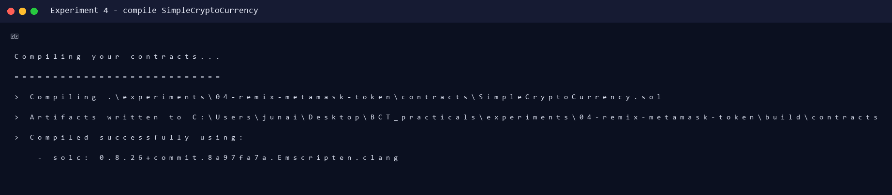
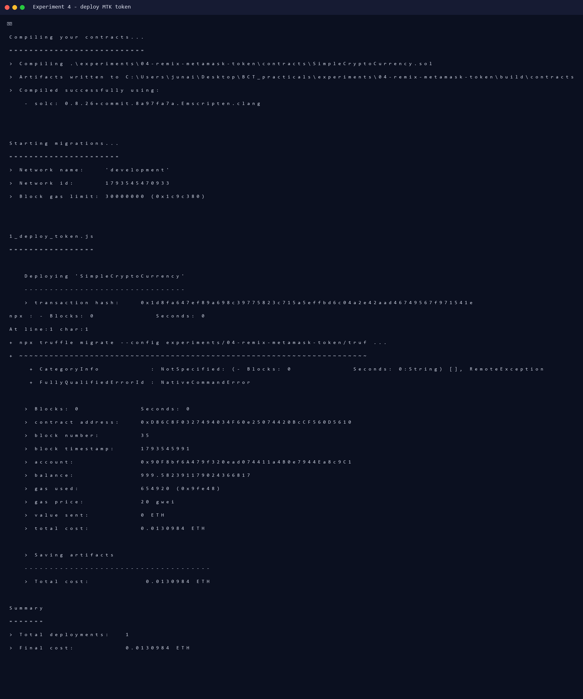
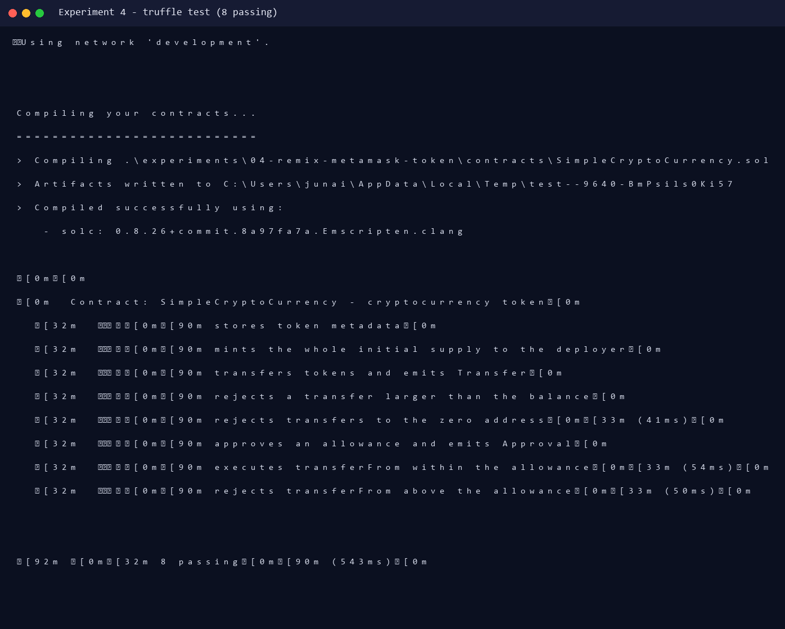
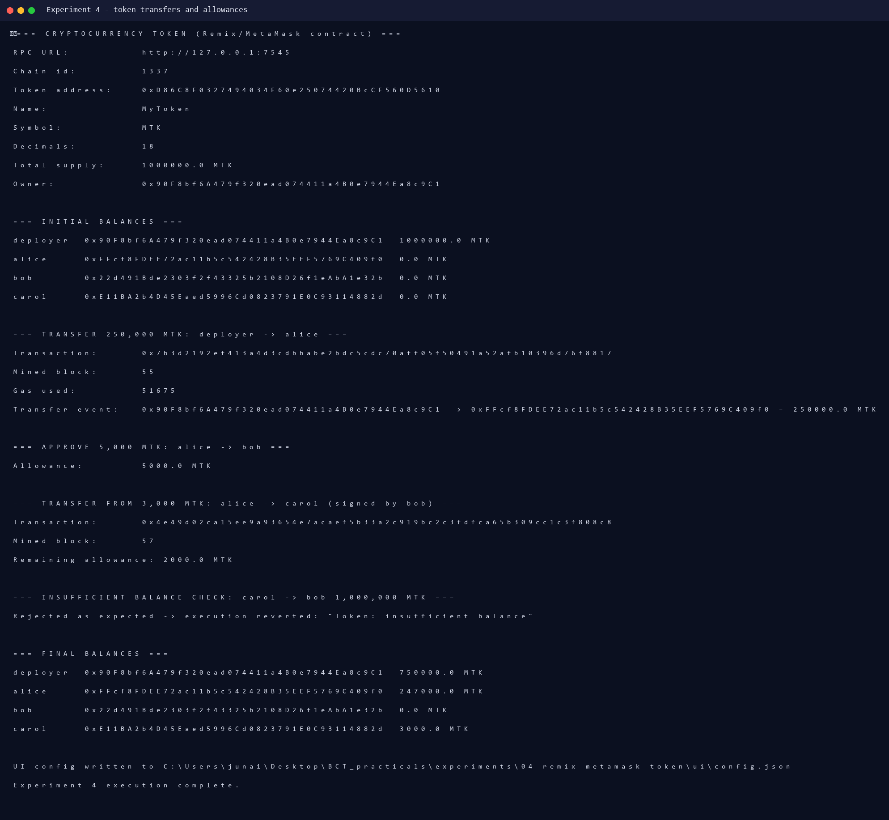
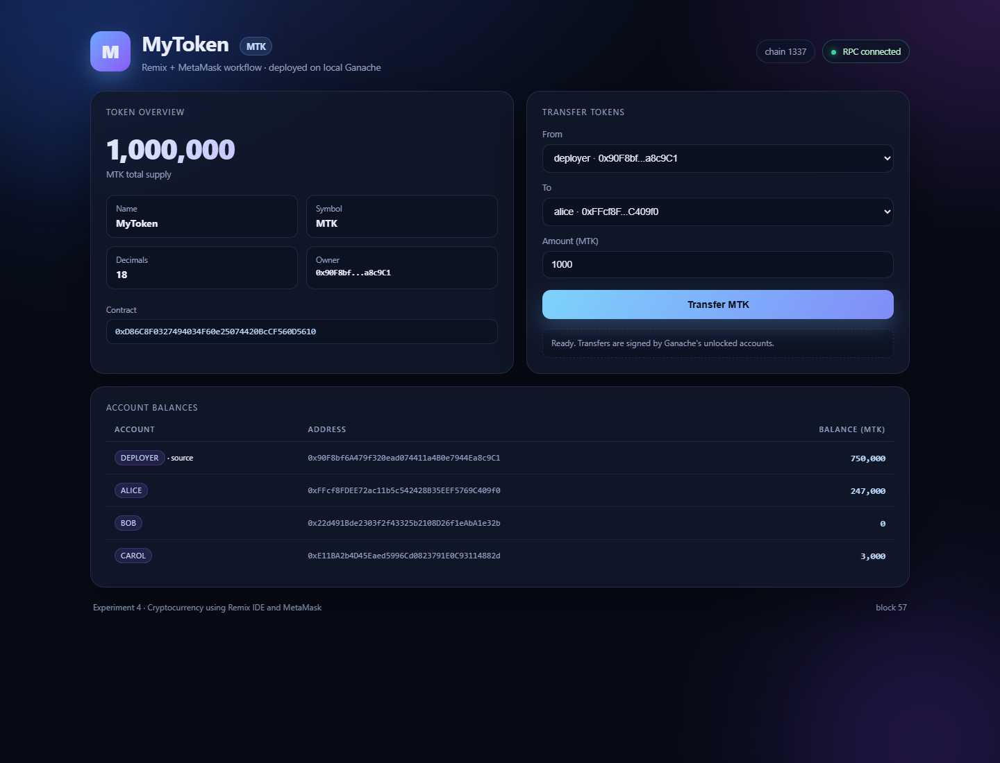
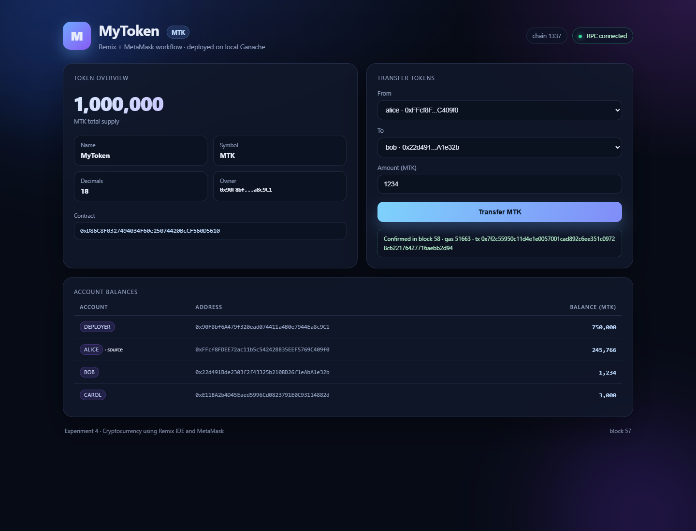

# Experiment 4 — Cryptocurrency using Remix IDE and MetaMask

**Aim:** To study and implement a smart contract using Remix IDE and MetaMask for the development and deployment of a cryptocurrency.

**Lab Outcomes:** LO 3 (Remix + MetaMask) and LO 4 (design and develop a cryptocurrency).

---

## 1. Theory

A **cryptocurrency** is a digital asset whose ownership is recorded on a blockchain and secured by cryptography. On Ethereum, a cryptocurrency is implemented as a smart contract that maintains a ledger of balances and exposes transfer functions. The de-facto standard is **ERC-20**, which defines:

- `name`, `symbol`, `decimals`, `totalSupply`
- `balanceOf(address)`
- `transfer(to, value)`
- `approve(spender, value)` and `allowance(owner, spender)`
- `transferFrom(from, to, value)`
- `Transfer` and `Approval` events

**Remix IDE** is a browser IDE for writing, compiling, deploying and debugging Solidity. **MetaMask** is a browser wallet that injects an Ethereum provider (`Injected Web3`) into Remix and signs deployment/transaction requests.

The contract in this experiment follows the lab manual's `SimpleCryptoCurrency` design (`balances` mapping + constructor minting) and adds the standard `balanceOf`, `approve`, `allowance` and `transferFrom` functions so it behaves like a real ERC-20 token.

---

## 2. Project Structure

```
experiments/04-remix-metamask-token/
├── contracts/SimpleCryptoCurrency.sol   # Remix-ready single file
├── migrations/1_deploy_token.js
├── scripts/interact_token.js            # real transfers/approvals
├── scripts/screenshot*.js               # Playwright dashboard captures
├── test/token.test.js                   # 8 Truffle tests
├── ui/                                  # local token dashboard (ethers.js)
├── truffle-config.js
└── output/                              # real logs + screenshots
```

---

## 3. Token Contract

Constructor parameters used in the lab: `_name = "MyToken"`, `_symbol = "MTK"`, `_decimals = 18`, `_initialSupply = 1000000`.

```solidity
constructor(
    string memory _name,
    string memory _symbol,
    uint8 _decimals,
    uint256 _initialSupply
) {
    owner = msg.sender;
    name = _name;
    symbol = _symbol;
    decimals = _decimals;
    totalSupply = _initialSupply * 10 ** uint256(_decimals);
    balances[msg.sender] = totalSupply;
    emit Transfer(address(0), msg.sender, totalSupply);
}

function transfer(address to, uint256 value) public returns (bool) {
    require(to != address(0), "Token: transfer to zero address");
    require(balances[msg.sender] >= value, "Token: insufficient balance");
    balances[msg.sender] -= value;
    balances[to] += value;
    emit Transfer(msg.sender, to, value);
    return true;
}
```

The full source also implements `approve` and `transferFrom` with allowance checks.

> **Troubleshooting note:** solc 0.8.26 defaults to the Cancun EVM version. Ganache 7.9.x implements Shanghai, so the first deployment hit an invalid opcode. Setting `evmVersion: "shanghai"` in `truffle-config.js` fixed it. This is a real issue that was encountered and resolved during the lab.

---

## 4. Execution

### 4.1 Compile and deploy

```powershell
npx truffle compile --config experiments/04-remix-metamask-token/truffle-config.js
npx truffle migrate --config experiments/04-remix-metamask-token/truffle-config.js `
  --network development --reset
```

Real deployment:

```text
Deploying 'SimpleCryptoCurrency'
   > transaction hash:    0x1d8fa647ef89a698c39775823c715a5effbd6c04a2e42aad46749567f971541e
   > contract address:    0xD86C8F0327494034F60e25074420BcCF560D5610
   > block number:        35
   > gas used:            654920
   > total cost:          0.0130984 ETH
```

### 4.2 Tests

```powershell
npx truffle test --config experiments/04-remix-metamask-token/truffle-config.js `
  --network development
```

```text
Contract: SimpleCryptoCurrency - cryptocurrency token
  ✔ stores token metadata
  ✔ mints the whole initial supply to the deployer
  ✔ transfers tokens and emits Transfer
  ✔ rejects a transfer larger than the balance
  ✔ rejects transfers to the zero address (41ms)
  ✔ approves an allowance and emits Approval
  ✔ executes transferFrom within the allowance (54ms)
  ✔ rejects transferFrom above the allowance (50ms)
8 passing (543ms)
```

### 4.3 Real token operations

```powershell
node experiments/04-remix-metamask-token/scripts/interact_token.js
```

**Inputs:** deployer starts with 1,000,000 MTK; transfer 250,000 MTK to alice; alice approves bob for 5,000 MTK; bob transfers 3,000 MTK from alice to carol; carol attempts to transfer 1,000,000 MTK.

**Real output:**

```text
Name:             MyToken
Symbol:           MTK
Decimals:         18
Total supply:     1000000.0 MTK
Token address:    0xD86C8F0327494034F60e25074420BcCF560D5610

=== TRANSFER 250,000 MTK: deployer -> alice ===
Transaction:      0x7b3d2192ef413a4d3cdbbabe2bdc5cdc70aff05f50491a52afb10396d76f8817
Mined block:      55
Gas used:         51675
Transfer event:   ... -> ... = 250000.0 MTK

=== APPROVE 5,000 MTK: alice -> bob ===
Allowance:        5000.0 MTK

=== TRANSFER-FROM 3,000 MTK: alice -> carol (signed by bob) ===
Transaction:      0x4e49d02ca15ee9a93654e7acaef5b33a2c919bc2c3fdfca65b309cc1c3f808c8
Mined block:      57
Remaining allowance: 2000.0 MTK

=== INSUFFICIENT BALANCE CHECK: carol -> bob 1,000,000 MTK ===
Rejected as expected -> execution reverted: "Token: insufficient balance"

=== FINAL BALANCES ===
deployer  750000.0 MTK
alice     247000.0 MTK
bob            0.0 MTK
carol       3000.0 MTK
```

### 4.4 Local token dashboard (browser execution)

The dashboard reads the deployed contract through `ethers.js` and signs transfers with Ganache's unlocked accounts — the same RPC flow MetaMask uses.

```powershell
python -m http.server 8080
# open http://127.0.0.1:8080/experiments/04-remix-metamask-token/ui/
```

A real transfer of **1,234 MTK from alice to bob** was submitted through the form. It was mined in block 58 with gas 51,663; alice's balance became 245,766 MTK and bob's became 1,234 MTK.

---

## 5. Screenshots (actual run)

| Screenshot | Description |
|---|---|
|  | Compilation with solc 0.8.26 (Shanghai EVM) |
|  | Token deployment transaction |
|  | 8/8 Truffle tests passing |
|  | Real transfers, approval, `transferFrom`, revert |
|  | Token dashboard after deployment |
|  | 1,234 MTK transfer submitted through the UI |

---

## 6. Remix IDE + MetaMask Workflow (manual steps)

1. Open <https://remix.ethereum.org> and create `SimpleCryptoCurrency.sol`; paste the contract.
2. **Solidity Compiler** tab → compiler `0.8.26` → **Compile**.
3. Install MetaMask, create/import an account, and switch the network to **Sepolia** (or a local Ganache RPC at `http://127.0.0.1:7545` with chain ID `1337`).
4. **Deploy & Run Transactions** → Environment: **Injected Provider - MetaMask**.
5. Constructor inputs: `_name = MyToken`, `_symbol = MTK`, `_decimals = 18`, `_initialSupply = 1000000`.
6. Click **Deploy** → confirm the transaction in MetaMask.
7. Use `balanceOf`, `transfer`, `approve` and `transferFrom` from the deployed contract panel. Every state-changing call is signed in MetaMask.
8. On Sepolia, the contract is published at its address and can be verified on Sepolia Etherscan.

The same contract was executed here on Ganache because MetaMask is a user-owned browser wallet; the dashboard demonstrates the identical contract calls and transaction signing flow.

---

## 7. Result

A complete ERC-20-style cryptocurrency (`MyToken`, symbol `MTK`, 18 decimals, 1,000,000 initial supply) was compiled, deployed and exercised. Real transfers, approvals and delegated transfers succeeded, while insufficient-balance and zero-address transfers reverted. All 8 tests passed, and the token was also driven from a browser dashboard.

**Conclusion:** Thus, a cryptocurrency was successfully designed, deployed and used with the Remix/MetaMask toolchain and an equivalent local execution environment.
