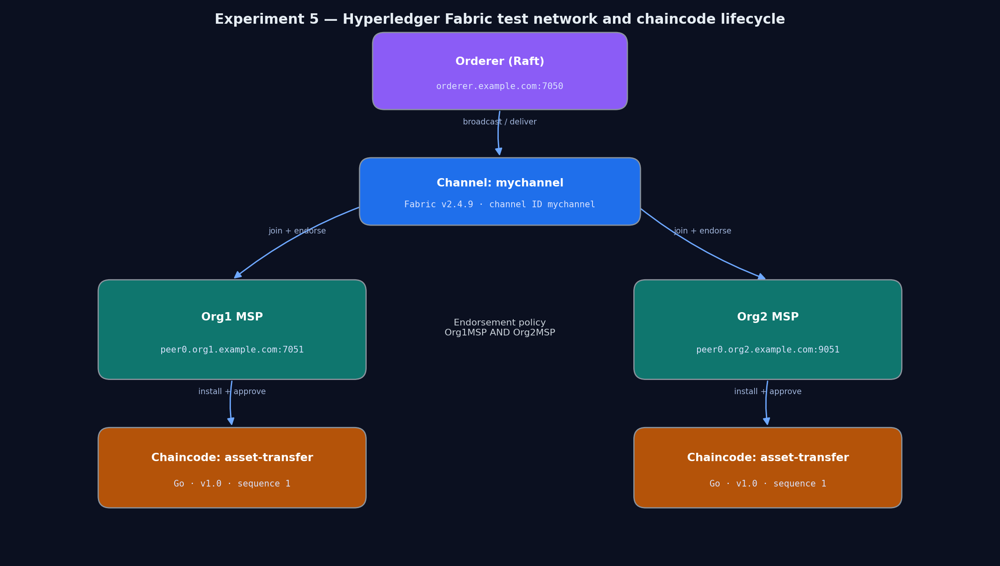
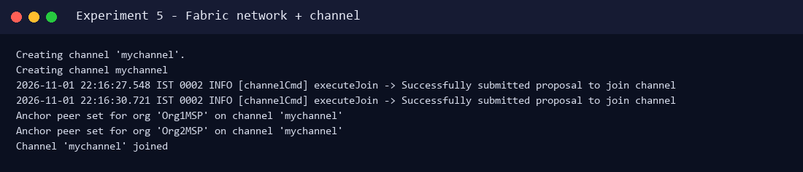
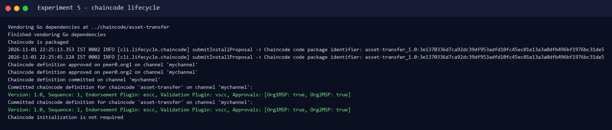
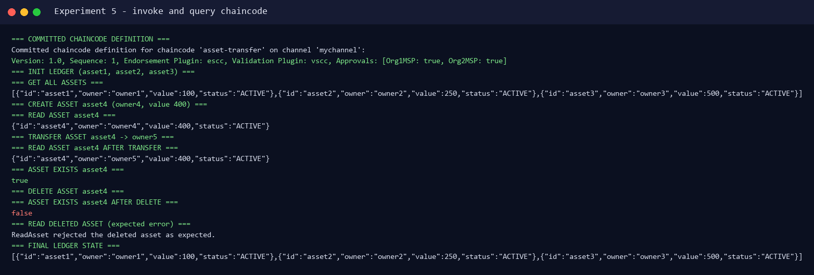
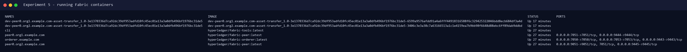

# Experiment 5 — Chaincode Deployment in Hyperledger Fabric

**Aim:** To study and implement the deployment of chaincode in Hyperledger Fabric.

**Lab Outcome:** LO 5 — Write and deploy chaincode in Hyperledger Fabric.

---

## 1. Theory

Hyperledger Fabric is a **permissioned** blockchain framework. Unlike Ethereum, participants are identified through an MSP (Membership Service Provider), and only authorized organizations can join a channel. The network separates three roles:

- **Orderer** — orders transactions and delivers blocks (Raft consensus in this lab).
- **Peers** — maintain the ledger, execute chaincode and endorse proposals.
- **Channel** — a private sub-network (here `mychannel`) shared by Org1 and Org2.

**Chaincode** is Fabric's smart contract. It runs inside a Docker container and reads/writes the world state through a `ChaincodeStub`. Deployment uses the Fabric 2.x lifecycle:

1. Package the chaincode.
2. Install the package on each peer.
3. Approve the chaincode definition for each organization.
4. Commit the definition to the channel.
5. Invoke/query transactions.

---

## 2. Chaincode

Source: `chaincode/asset-transfer/asset_transfer.go` (Go, `fabric-contract-api-go v1.2.0`).

Functions implemented:

| Function | Purpose |
|---|---|
| `InitLedger` | Seeds `asset1`, `asset2`, `asset3` |
| `CreateAsset(id, owner, value)` | Creates a new active asset |
| `ReadAsset(id)` | Returns the asset JSON |
| `TransferAsset(id, newOwner)` | Changes ownership and emits `AssetTransferred` |
| `DeleteAsset(id)` | Removes the asset from world state |
| `AssetExists(id)` | Returns `true`/`false` |
| `GetAllAssets()` | Range-scans the world state |

Core create logic:

```go
func (s *SmartContract) CreateAsset(ctx contractapi.TransactionContextInterface, id string, owner string, value int) error {
    if strings.TrimSpace(id) == "" {
        return fmt.Errorf("asset id must not be empty")
    }
    if value <= 0 {
        return fmt.Errorf("asset value must be greater than zero")
    }
    exists, err := s.AssetExists(ctx, id)
    if err != nil {
        return err
    }
    if exists {
        return fmt.Errorf("asset %s already exists", id)
    }

    asset := Asset{ID: id, Owner: owner, Value: value, Status: "ACTIVE"}
    assetJSON, err := json.Marshal(asset)
    if err != nil {
        return err
    }
    if err := ctx.GetStub().PutState(id, assetJSON); err != nil {
        return fmt.Errorf("failed to put asset %s: %w", id, err)
    }
    return ctx.GetStub().SetEvent("AssetCreated", assetJSON)
}
```

---

## 3. Network Topology



The official `fabric-samples/test-network` was used: one Raft orderer, Org1 peer (`localhost:7051`), Org2 peer (`localhost:9051`), channel `mychannel`, and the `asset-transfer` chaincode approved by both organizations.

---

## 4. Execution

Environment: WSL2 Ubuntu + Docker Desktop, Fabric 2.4.9 binaries/images, Go 1.22.5, `jq` 1.6.

### 4.1 Start the network and create the channel

```bash
cd ~/fabric-samples/test-network
./network.sh up createChannel -c mychannel
```

Real output (abridged):

```text
Creating channel 'mychannel'.
Successfully submitted proposal to join channel
Anchor peer set for org 'Org1MSP' on channel 'mychannel'
Anchor peer set for org 'Org2MSP' on channel 'mychannel'
Channel 'mychannel' joined
```

### 4.2 Deploy the chaincode

```bash
./network.sh deployCC \
  -ccn asset-transfer \
  -ccp ../chaincode/asset-transfer \
  -ccl go
```

Real lifecycle output (abridged):

```text
Vendoring Go dependencies at ../chaincode/asset-transfer
Finished vendoring Go dependencies
Chaincode is packaged
Chaincode code package identifier: asset-transfer_1.0:3e1370336d7ca92dc39df953adfd10fc45ec01e13a3a0dfb496bf1976bc31de5
Chaincode definition approved on peer0.org1 on channel 'mychannel'
Chaincode definition approved on peer0.org2 on channel 'mychannel'
Chaincode definition committed on channel 'mychannel'
Committed chaincode definition for chaincode 'asset-transfer' on channel 'mychannel':
Version: 1.0, Sequence: 1, Endorsement Plugin: escc, Validation Plugin: vscc,
Approvals: [Org1MSP: true, Org2MSP: true]
```

### 4.3 Invoke and query

```bash
bash experiments/05-hyperledger-chaincode/scripts/fabric_demo.sh
```

Real output:

```text
=== COMMITTED CHAINCODE DEFINITION ===
Version: 1.0, Sequence: 1, Endorsement Plugin: escc, Validation Plugin: vscc,
Approvals: [Org1MSP: true, Org2MSP: true]

=== INIT LEDGER (asset1, asset2, asset3) ===
=== GET ALL ASSETS ===
[{"id":"asset1","owner":"owner1","value":100,"status":"ACTIVE"},
 {"id":"asset2","owner":"owner2","value":250,"status":"ACTIVE"},
 {"id":"asset3","owner":"owner3","value":500,"status":"ACTIVE"}]

=== CREATE ASSET asset4 (owner4, value 400) ===
=== READ ASSET asset4 ===
{"id":"asset4","owner":"owner4","value":400,"status":"ACTIVE"}

=== TRANSFER ASSET asset4 -> owner5 ===
=== READ ASSET asset4 AFTER TRANSFER ===
{"id":"asset4","owner":"owner5","value":400,"status":"ACTIVE"}

=== ASSET EXISTS asset4 ===
true

=== DELETE ASSET asset4 ===
=== ASSET EXISTS asset4 AFTER DELETE ===
false

=== READ DELETED ASSET (expected error) ===
ReadAsset rejected the deleted asset as expected.

=== FINAL LEDGER STATE ===
[{"id":"asset1","owner":"owner1","value":100,"status":"ACTIVE"},
 {"id":"asset2","owner":"owner2","value":250,"status":"ACTIVE"},
 {"id":"asset3","owner":"owner3","value":500,"status":"ACTIVE"}]
```

### 4.4 Running containers during the lab

```text
peer0.org1.example.com    hyperledger/fabric-peer:latest       Up   0.0.0.0:7051->7051/tcp
peer0.org2.example.com    hyperledger/fabric-peer:latest       Up   0.0.0.0:9051->9051/tcp
orderer.example.com       hyperledger/fabric-orderer:latest    Up   0.0.0.0:7050->7050/tcp
cli                       hyperledger/fabric-tools:latest      Up
dev-peer0.org1...         asset-transfer chaincode image       Up
dev-peer0.org2...         asset-transfer chaincode image       Up
```

The network was shut down after capturing the evidence (`./network.sh down`) to free CPU/RAM. The Fabric Docker images are removed in the final cleanup step.

---

## 5. Screenshots (actual run)

| Screenshot | Description |
|---|---|
|  | Test-network topology |
|  | Channel creation and join |
|  | Package, install, approve, commit |
|  | Init, create, read, transfer, delete, query |
|  | Running Fabric containers |

---

## 6. Issues Encountered and Fixed

These were real environment issues, not simulated:

1. **`jq` missing on the host** — `deployCC.sh` checks for it; installed `jq 1.6` via apt.
2. **`FABRIC_CFG_PATH` pointed to `configtx`** — the peer CLI needs `fabric-samples/config` (which contains `core.yaml`); fixed in the demo script.
3. **`OVERRIDE_ORG: unbound variable`** — caused by `set -u` combined with `envVar.sh`; removed `-u` from the demo script.
4. **Docker image tags** — the compose files use `:latest`; the downloaded 2.4.9 images were tagged `latest`/`2.4` so the network could start.
5. **No Go on the host** — installed Go 1.22.5 and ran `go mod vendor` before packaging the chaincode.

---

## 7. Result

The `asset-transfer` Go chaincode was packaged, installed on both peers, approved by Org1 and Org2, and committed to `mychannel`. Real transactions created `asset4`, read it, transferred it from `owner4` to `owner5`, confirmed its existence, deleted it, and confirmed that a deleted asset can no longer be read. The ledger still contained the three genesis assets.

**Conclusion:** Thus, chaincode was successfully deployed and invoked on a permissioned Hyperledger Fabric network.
