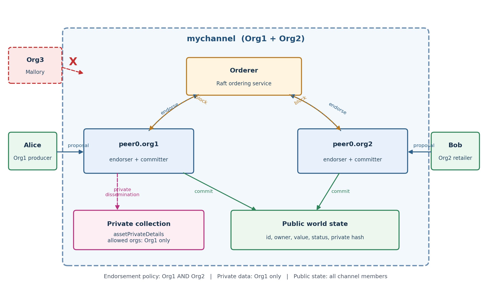
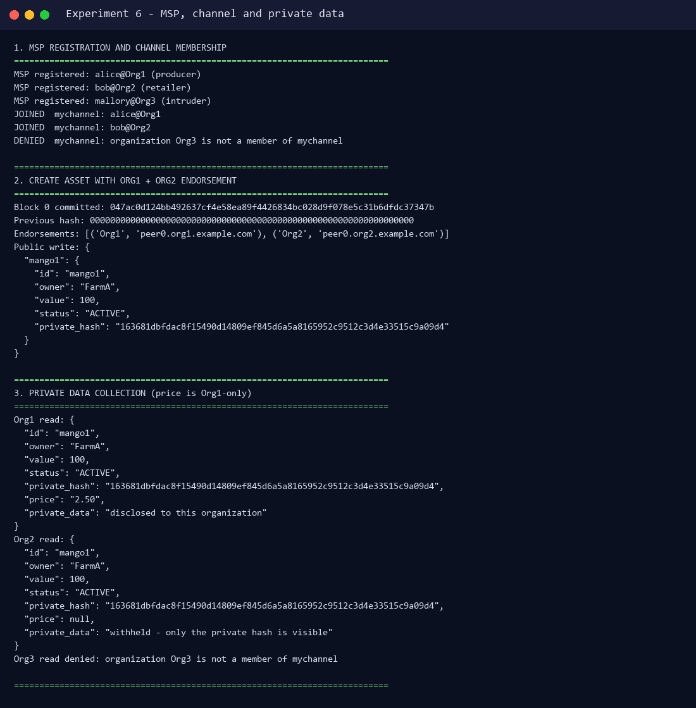
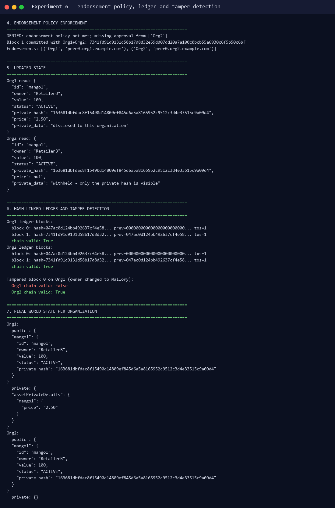

# Experiment 6 — Case Study on Hyperledger Blockchain Platform

**Aim:** To study the Hyperledger blockchain platform with a real-world permissioned-network case study.

**Lab Outcome:** LO 6 — Understand Hyperledger and its enterprise use cases.

---

## 1. What is Hyperledger?

Hyperledger is an open-source umbrella project hosted by the Linux Foundation for **enterprise blockchain** applications. Its frameworks and tools are designed for **permissioned** networks, where every participant has a known identity and a defined role.

| Project | Type | Purpose |
|---|---|---|
| **Hyperledger Fabric** | Framework | Modular permissioned blockchain with channels, private data and pluggable consensus |
| Hyperledger Sawtooth | Framework | Enterprise blockchain with a modular consensus layer |
| Hyperledger Iroha | Framework | Simple permissioned ledger for mobile and financial use cases |
| Hyperledger Besu | Framework | Ethereum-compatible client for public and private networks |
| Hyperledger Indy | Framework | Decentralized identity |
| Hyperledger Cactus | Tool | Cross-ledger interoperability |
| Hyperledger Caliper | Tool | Blockchain benchmarking |

This case study focuses on **Hyperledger Fabric**, the most widely used framework for enterprise supply chains.

### Permissioned vs. public blockchains

| Property | Public (e.g. Ethereum) | Permissioned (Hyperledger Fabric) |
|---|---|---|
| Participation | Open to anyone | Invitation only, MSP-verified identities |
| Privacy | Transactions visible to all | Channels and private data collections |
| Consensus | PoW / PoS | Pluggable, commonly Raft (crash-fault tolerant) |
| Smart contracts | Solidity/EVM | Chaincode in Go, Java, JavaScript or TypeScript |
| Throughput | Limited by public consensus | Higher; no mining, parallel endorsement |
| Governance | Community/protocol | Consortium of known organizations |

---

## 2. Case Study: IBM Food Trust and Walmart

### 2.1 Problem

Food supply chains involve many independent parties: farms, processors, distributors, logistics providers, retailers and regulators. When a foodborne-illness outbreak occurs, investigators must trace a contaminated batch through paper records and disconnected databases. In the Walmart mango pilot, tracing a package back to its farm took **almost seven days**. During that time, contaminated products may remain on shelves, and large volumes of safe food may be recalled unnecessarily.

### 2.2 Solution

IBM Food Trust is a permissioned blockchain built on **Hyperledger Fabric**. Walmart, Sam's Club, Carrefour, Nestlé, Dole, Golden State Foods, Kroger, McLane, Tyson Foods and Unilever have participated in the ecosystem.

Each food batch receives a digital identity. Supply-chain events are written as chaincode transactions:

1. **Harvest** — farm creates a batch (product, farm, harvest date, quantity).
2. **Process** — processor adds processing and packaging events.
3. **Ship** — carrier records temperature, location and handover.
4. **Receive** — retailer confirms receipt.
5. **Recall/audit** — regulator or retailer queries the complete provenance in seconds.

In the Walmart pilot, the time to trace a mango package fell from **~7 days to 2.2 seconds**. Walmart then required leafy-green suppliers to onboard to IBM Food Trust, improving food-safety response and reducing waste.

### 2.3 Why a permissioned blockchain?

- **Known participants** — a farm, carrier or regulator must be approved by the consortium MSP.
- **Confidential business data** — prices and contracts are shared only with the relevant parties through private data collections.
- **Shared source of truth** — all parties see the same provenance events without a central database owner.
- **Auditability** — every event is endorsed, ordered and stored in a hash-linked ledger.
- **No mining** — Raft ordering gives fast finality suitable for retail supply chains.

---

## 3. Fabric Architecture Used in the Case Study



| Component | Role in the food network |
|---|---|
| **MSP** | Registers farms, processors, carriers and retailers; rejects unknown organizations |
| **Channel** | `mychannel` — private subnet for the participating consortium |
| **Peer** | Each organization runs an endorsing/committing peer holding the ledger |
| **Orderer** | Raft service that orders endorsed transactions into blocks |
| **Chaincode** | `FoodTrustChaincode` — create, read and transfer food batches |
| **Endorsement policy** | A write needs approval from **Org1 AND Org2** |
| **Private data collection** | `assetPrivateDetails` — price visible only to Org1 |
| **Public world state** | Batch id, owner, value, status and the private-data hash |

### Transaction flow

1. The client sends a proposal to the peers.
2. Each peer simulates the chaincode against its ledger and returns an endorsement.
3. The client submits the endorsements to the orderer.
4. The orderer checks the endorsement policy and creates a block.
5. The block is distributed to the peers, which validate and commit it.
6. Private data is disseminated only to peers in the collection's allowed organizations.

---

## 4. Hands-on Simulation

The case study is demonstrated by `simulator/fabric_sim.py` (Python standard library only). It implements the Fabric concepts above:

- `MSP` — identity registration and membership checks.
- `Peer` / `Orderer` / `FabricNetwork` — proposal, endorsement, ordering and commit.
- `FoodTrustChaincode` — `create_asset`, `transfer_asset`, `read_asset`.
- `Collection` — private data access policy.
- `Block` / `Ledger` — SHA-256 hash-linked blocks and tamper detection.

Run it with:

```bash
python experiments/06-hyperledger-case-study/simulator/fabric_sim.py
```

### 4.1 Permissioning and private data



Actual results:

```text
MSP registered: alice@Org1 (producer)
MSP registered: bob@Org2 (retailer)
MSP registered: mallory@Org3 (intruder)
JOINED  mychannel: alice@Org1
JOINED  mychannel: bob@Org2
DENIED  mychannel: organization Org3 is not a member of mychannel

Block 0 committed: 047ac0d124bb492637cf4e58ea89f4426834bc028d9f078e5c31b6dfdc37347b
Endorsements: [('Org1', 'peer0.org1.example.com'), ('Org2', 'peer0.org2.example.com')]

Org1 read price: "2.50"  (private data disclosed)
Org2 read price: null    (only the private hash is visible)
Org3 read: denied by the channel MSP
```

### 4.2 Endorsement policy, ledger and tamper detection



Actual results:

```text
DENIED: endorsement policy not met; missing approval from ['Org2']
Block 1 committed with Org1+Org2: 7341fd91d9131d58b17d8d32e59dd07dd20a7a100c0bcb55a6930c6f5b50c6bf

Org1 ledger blocks:
  block 0: hash=047ac0d124bb492637cf4e58... prev=000000000000000000000000... txs=1
  block 1: hash=7341fd91d9131d58b17d8d32... prev=047ac0d124bb492637cf4e58... txs=1
  chain valid: True

Tampered block 0 on Org1 (owner changed to Mallory):
  Org1 chain valid: False
  Org2 chain valid: True
```

The last result shows the key property of a distributed ledger: changing a committed block on one peer breaks that peer's hash chain, while the other peer's copy remains valid. In a real Fabric network, the tampered peer would be unable to gossip a valid block and would be corrected/rejected by the consortium.

### 4.3 Final world state

```text
Org1 public : mango1 -> owner RetailerB, value 100, status ACTIVE
Org1 private: assetPrivateDetails/mango1 -> price "2.50"
Org2 public : mango1 -> owner RetailerB, value 100, status ACTIVE
Org2 private: {}   (Org2 is not in the private collection policy)
```

The public provenance is shared by both organizations, while the commercial price remains confidential to Org1. This is the core privacy model used by IBM Food Trust.

---

## 5. Relation to Experiment 5

Experiment 5 deployed the **real** `asset-transfer` chaincode on a Fabric 2.4.9 test network with Docker peers, an orderer, `mychannel`, Org1/Org2 approvals and live invoke/query transactions. This experiment builds on that experience by explaining the enterprise case study and modelling the same concepts in a small, inspectable simulator.

| Experiment 5 (real Fabric) | Experiment 6 (case-study simulator) |
|---|---|
| Docker peers, orderer, channel | Python objects modelling the same roles |
| Go chaincode lifecycle | `FoodTrustChaincode` methods |
| MSP + Org1/Org2 approvals | `MSP` + endorsement policy |
| Private data collections | `Collection(allowed_orgs={"Org1"})` |
| Hash-linked ledger | SHA-256 `Block` chain + `validate()` |

---

## 6. Benefits and Challenges

**Benefits**

- End-to-end traceability in seconds instead of days.
- Faster recalls and less food waste.
- Shared, auditable record among competing organizations.
- Confidential pricing via private data collections.
- Permissioned identities and consortium governance.

**Challenges**

- Onboarding every supplier and standardizing data formats.
- Integration with legacy ERP and IoT systems.
- Governance: who operates the orderer, who approves members.
- Cost of running redundant peers and orderers.
- Privacy tuning: collection policies must be designed carefully.
- Scalability of channels and chaincode across large consortiums.

---

## 7. Conclusion

Hyperledger Fabric provides the permissioning, privacy and modular architecture needed for enterprise supply chains. The IBM Food Trust case study shows how a consortium of food companies used Fabric to reduce mango traceability from about seven days to 2.2 seconds. The simulation reproduced the essential mechanics — MSP admission, channel membership, Org1+Org2 endorsement, Org1-only private pricing, hash-linked blocks and tamper detection — on a small, reproducible example.

---

## References

- Hyperledger Fabric documentation — https://hyperledger-fabric.readthedocs.io/
- Hyperledger Foundation — https://www.hyperledger.org/
- IBM Food Trust — https://www.ibm.com/products/ibm-food-trust
- Walmart food traceability case study — https://www.ibm.com/case-studies/walmart
