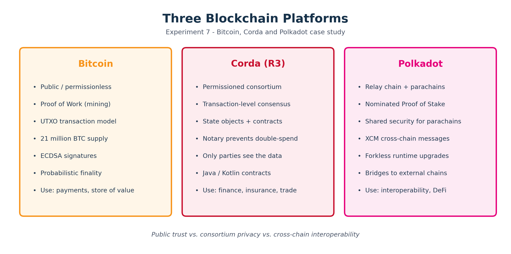
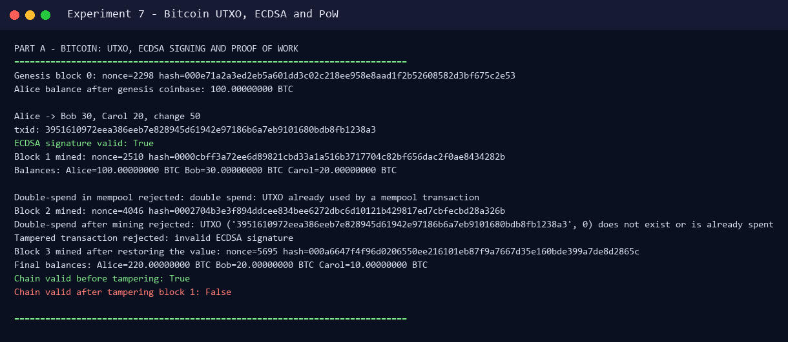
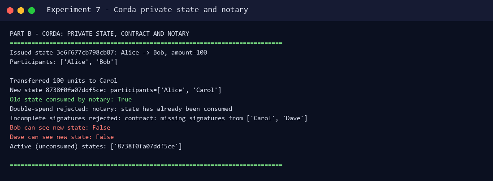
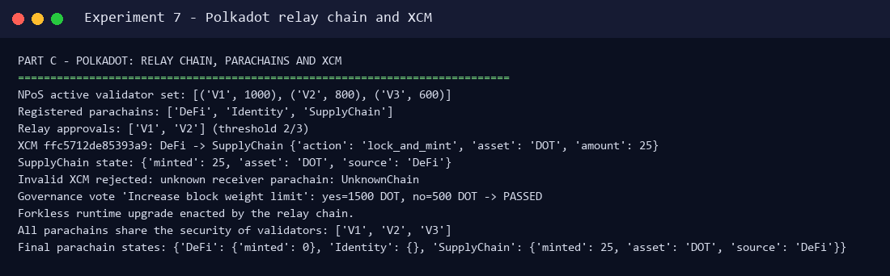

# Experiment 7 — Case Study on Bitcoin, Corda and Polkadot

**Aim:** To study Bitcoin and other blockchain platforms (Corda and Polkadot).

**Lab Outcome:** LO 7 — Compare public, permissioned and interoperable blockchain platforms.

---

## 1. Bitcoin

### 1.1 Overview

Bitcoin, introduced in 2009 by the pseudonymous **Satoshi Nakamoto**, is the first successful public blockchain and cryptocurrency. It is a peer-to-peer electronic cash system that transfers value without a bank or other intermediary.

### 1.2 Architecture

- **Public and permissionless** — anyone can run a node, validate transactions or mine.
- **UTXO model** — coins are unspent transaction outputs. A transaction consumes previous outputs and creates new ones.
- **Blocks** — transactions are grouped into blocks linked by the hash of the previous block.
- **Nodes** — thousands of independent nodes maintain and validate the chain.
- **Wallets** — hold private keys; the blockchain stores only public keys/addresses and signatures.

### 1.3 Consensus — Proof of Work

Miners repeatedly hash the block header with different nonce values until the hash is below the network target. The first valid block is broadcast, and the miner receives a block reward plus fees. Altering a past block requires redoing the work for that block and every later block, which is economically impractical on a large network.

### 1.4 Use cases and limitations

Bitcoin is used as a store of value, a medium of exchange, for cross-border remittances and as the base layer of the Lightning Network. It has strong security and a fixed supply of 21 million BTC, but limited smart-contract capability, low throughput compared with enterprise platforms and high energy consumption from PoW.

---

## 2. Corda

### 2.1 Overview

Corda, developed by **R3**, is a permissioned blockchain platform for regulated industries such as finance, insurance, healthcare and trade finance. Privacy and legal enforceability are central design goals.

### 2.2 Architecture

- **Permissioned network** — only authorized participants join.
- **Point-to-point privacy** — transactions are shared only with the parties involved, not broadcast to the whole network.
- **State objects and contracts** — states represent agreements; contracts written in Java/Kotlin verify state transitions.
- **Notary nodes** — prevent double-spending by recording which states have been consumed, without seeing the transaction contents.
- **Transaction-level consensus** — only the parties affected by a transaction need to agree; there is no global block-wide consensus.

### 2.3 Use cases and advantages

Corda is used for cross-border payments, settlements, reinsurance (B3i), trade finance and supply-chain finance. It offers confidentiality, integration with legacy systems and legally enforceable contracts.

---

## 3. Polkadot

### 3.1 Overview

Polkadot, created by **Gavin Wood** (co-founder of Ethereum), is a multi-chain platform designed for interoperability — a "blockchain of blockchains".

### 3.2 Architecture

- **Relay chain** — provides shared security, consensus and cross-chain messaging; it does not run smart contracts directly.
- **Parachains** — independent chains running in parallel with their own rules, governance and tokens.
- **Bridges** — connect Polkadot to external chains such as Ethereum and Bitcoin.
- **XCM** — Cross-Consensus Messaging format for communication between parachains.

### 3.3 Consensus and governance

Polkadot uses **Nominated Proof of Stake (NPoS)**. Nominators stake DOT to elect validators; the active validator set produces blocks and secures all parachains. All parachains benefit from the relay chain's shared security. DOT holders vote on upgrades, enabling forkless runtime upgrades.

### 3.4 Use cases

Cross-chain DeFi (Acala), smart contracts (Moonbeam), gaming and NFTs (Efinity), identity and oracle integrations (Chainlink).

---

## 4. Platform Comparison



| Property | Bitcoin | Corda | Polkadot |
|---|---|---|---|
| Access | Public / permissionless | Permissioned consortium | Public, nominated validators |
| Consensus | Proof of Work | Transaction-level + notary | Nominated Proof of Stake |
| Data model | UTXO | State objects | Relay chain + parachains |
| Privacy | Public ledger | Only involved parties | Parachain-specific |
| Smart contracts | Limited (Script) | Java/Kotlin contracts | Parachain runtimes / EVM |
| Interoperability | Limited | Corda networks / oracles | XCM + bridges |
| Finality | Probabilistic | Notary-based | GRANDPA finality |
| Typical use | Payments, store of value | Finance, insurance, trade | Cross-chain DeFi, interoperability |

---

## 5. Hands-on Demonstration

The script `simulator/platforms_demo.py` demonstrates one core mechanism from each platform using Python:

- **Bitcoin** — real ECDSA (secp256k1) signatures, UTXO selection, mempool double-spend checks, simplified PoW mining and hash-chain validation.
- **Corda** — state objects, participant-based privacy, contract signature checks and a notary that prevents double-spending.
- **Polkadot** — NPoS validator election, relay-chain approval of XCM messages, parachain state updates and DOT-weighted governance.

Install the only dependency and run:

```bash
pip install ecdsa
python experiments/07-bitcoin-corda-polkadot/simulator/platforms_demo.py
```

### 5.1 Bitcoin — UTXO, ECDSA and Proof of Work



Actual output (this run):

```text
Genesis block 0: nonce=2298 hash=000e71a2a3ed2eb5a601dd3c02c218ee...
Alice balance after genesis coinbase: 100.00000000 BTC

Alice -> Bob 30, Carol 20, change 50
txid: 3951610972eea386eeb7e828945d61942e97186b6a7eb9101680bdb8fb1238a3
ECDSA signature valid: True
Block 1 mined: nonce=2510 hash=0000cbff3a72ee6d89821cbd33a1a516...
Balances: Alice=100.00000000 BTC Bob=30.00000000 BTC Carol=20.00000000 BTC

Double-spend in mempool rejected: double spend: UTXO already used by a mempool transaction
Block 2 mined: nonce=4046 hash=0002704b3e3f894ddcee834bee6272dbc6...
Double-spend after mining rejected: UTXO (...) does not exist or is already spent
Tampered transaction rejected: invalid ECDSA signature
Block 3 mined after restoring the value: nonce=5695 hash=000a6647f4f96d02...
Final balances: Alice=220.00000000 BTC Bob=20.00000000 BTC Carol=10.00000000 BTC
Chain valid before tampering: True
Chain valid after tampering block 1: False
```

What this proves:

- The signature covers the transaction outputs: changing an output invalidates the ECDSA signature.
- A UTXO can be spent only once; both the mempool and the confirmed UTXO set reject double-spends.
- PoW requires a hash with a fixed number of leading zeros; the nonce is the proof.
- Tampering with a confirmed block breaks the hash chain.

### 5.2 Corda — private state and notary



Actual output:

```text
Issued state 3e6f677cb798cb87: Alice -> Bob, amount=100
Participants: ['Alice', 'Bob']

Transferred 100 units to Carol
New state 8738f0fa07ddf5ce: participants=['Alice', 'Carol']
Old state consumed by notary: True
Double-spend rejected: notary: state has already been consumed
Incomplete signatures rejected: contract: missing signatures from ['Carol', 'Dave']
Bob can see new state: False
Dave can see new state: False
Active (unconsumed) states: ['8738f0fa07ddf5ce']
```

This mirrors Corda's privacy model: only participants of a state can see it, the contract requires the relevant signatures, and the notary guarantees that a consumed state cannot be used again.

### 5.3 Polkadot — relay chain, parachains and XCM



Actual output:

```text
NPoS active validator set: [('V1', 1000), ('V2', 800), ('V3', 600)]
Registered parachains: ['DeFi', 'Identity', 'SupplyChain']
Relay approvals: ['V1', 'V2'] (threshold 2/3)
XCM ffc5712de85393a9: DeFi -> SupplyChain {'action': 'lock_and_mint', 'asset': 'DOT', 'amount': 25}
SupplyChain state: {'minted': 25, 'asset': 'DOT', 'source': 'DeFi'}
Invalid XCM rejected: unknown receiver parachain: UnknownChain
Governance vote 'Increase block weight limit': yes=1500 DOT, no=500 DOT -> PASSED
Forkless runtime upgrade enacted by the relay chain.
All parachains share the security of validators: ['V1', 'V2', 'V3']
```

The relay chain elects validators by stake, approves the cross-chain message and delivers it to the target parachain. The same validator set secures every parachain, which is the core Polkadot value proposition.

---

## 6. Observations

| Platform | Strength | Trade-off |
|---|---|---|
| Bitcoin | Maximum decentralization and security | Slow, energy-intensive, limited contracts |
| Corda | Strong privacy and legal fit for regulated firms | Not a public network; consortium governance |
| Polkadot | Shared security and cross-chain interoperability | More complex architecture; relay-chain dependency |

The three platforms are not direct substitutes: Bitcoin optimizes for trustless public money, Corda for confidential business agreements, and Polkadot for a connected multi-chain ecosystem.

---

## 7. Conclusion

Bitcoin, Corda and Polkadot represent three different design points in blockchain engineering: public proof-of-work money, permissioned privacy-preserving finance, and interoperable shared-security parachains. The runnable demo exercised the defining mechanisms of each — UTXO/ECDSA/PoW, Corda state/notary privacy, and Polkadot NPoS/XCM — and confirmed their behaviour with real cryptographic signatures and deterministic ledger checks.

---

## References

- Bitcoin whitepaper — https://bitcoin.org/bitcoin.pdf
- Corda documentation — https://docs.r3.com/
- Polkadot documentation — https://docs.polkadot.com/
- Hyperledger Fabric (Experiment 5) — https://hyperledger-fabric.readthedocs.io/
