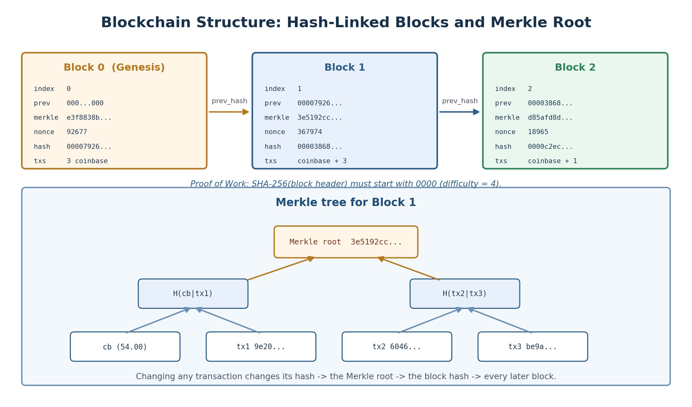
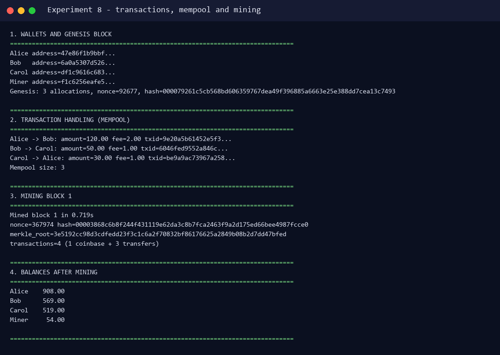
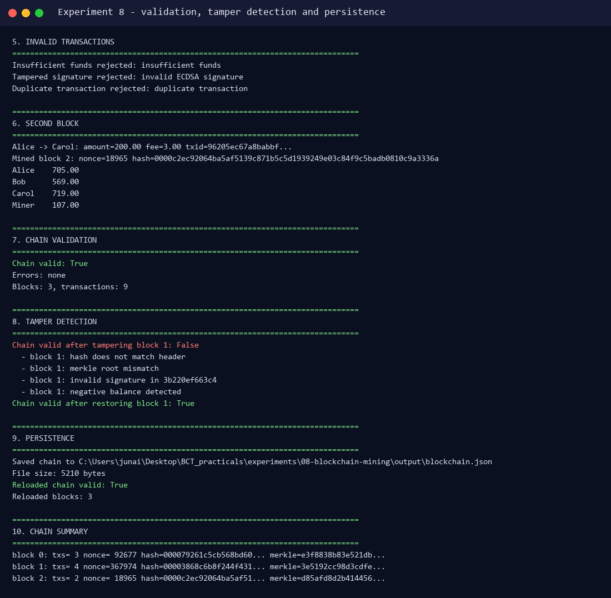

# Experiment 8 — Blockchain Application with Transactions, Mining and Validation

**Aim:** To study and implement the creation of a blockchain application with transaction handling, mining and chain validation.

**Lab Outcome:** LO 8 — Build a working blockchain with signed transactions and Proof of Work.

---

## 1. Theory

A blockchain is a distributed, append-only ledger. Each block contains a set of transactions and a cryptographic link to the previous block. Because changing a past transaction changes its hash, the block hash, and every later block, the ledger is tamper-evident.

| Component | Role |
|---|---|
| **Transaction** | Transfers value from a sender to a receiver and carries a digital signature |
| **Block** | Groups transactions with an index, previous hash, timestamp, Merkle root and nonce |
| **Merkle root** | One hash that commits to every transaction in the block |
| **Mining** | Repeatedly changes the nonce until the block hash satisfies the difficulty target |
| **Proof of Work** | The valid hash (e.g. four leading zeros) proves computational effort |
| **Chain validation** | Recomputes hashes, checks links, PoW, Merkle roots, signatures and balances |
| **Mempool** | Holds valid transactions waiting to be included in the next block |

### Transaction lifecycle

1. A wallet creates a transaction and signs its `txid` with its private key.
2. The node verifies the signature, the sender's balance and duplicate/double-spend rules.
3. The transaction enters the mempool.
4. A miner selects mempool transactions, adds a coinbase reward, and mines a block.
5. The block is appended; balances are updated; the mempool is cleared.
6. Any peer can replay the chain and validate every block.

---

## 2. Implementation

Source: `simulator/blockchain_app.py`.

### 2.1 Signed transactions

```python
def payload(self) -> str:
    return json.dumps({
        "sender": self.sender,
        "receiver": self.receiver,
        "amount": self.amount,
        "fee": self.fee,
        "timestamp": self.timestamp,
        "coinbase": self.coinbase,
    }, sort_keys=True)

def txid(self) -> str:
    return sha256(self.payload())

def sign(self, wallet: Wallet) -> None:
    self.sender_pubkey = wallet.pubkey
    self.signature = wallet.sign(self.txid())
```

The signature covers the sender, receiver, amount, fee and timestamp. Changing any field changes the `txid`, so the ECDSA signature no longer verifies.

### 2.2 Merkle root

```python
@staticmethod
def compute_merkle_root(transactions: list[Transaction]) -> str:
    if not transactions:
        return sha256("")
    layer = [tx.txid() for tx in transactions]
    while len(layer) > 1:
        if len(layer) % 2 == 1:
            layer.append(layer[-1])
        layer = [sha256(layer[i] + layer[i + 1]) for i in range(0, len(layer), 2)]
    return layer[0]
```

### 2.3 Mining

```python
while True:
    header = "|".join([
        str(index), previous_hash, f"{timestamp:.6f}", merkle_root, str(nonce)
    ])
    block_hash = sha256(header)
    if block_hash.startswith("0" * self.difficulty):
        break
    nonce += 1
```

With `difficulty = 4`, the hash must begin with `0000`. The expected number of attempts is about `16^4 = 65,536`.

### 2.4 Validation checks

`validate_chain()` verifies:

- Each block hash matches its header.
- Each block has the required Proof of Work.
- Each `previous_hash` matches the previous block.
- The Merkle root matches the transactions.
- Every non-coinbase transaction has a valid ECDSA signature.
- There are no duplicate transaction IDs.
- The coinbase reward equals the block reward plus fees.
- No account balance becomes negative when transactions are replayed.
- The genesis block has the zero previous hash and only coinbase allocations.

---

## 3. Structure



The genesis block distributes the initial supply. Each later block contains one coinbase transaction (reward + fees) followed by transfers. The Merkle root in the header commits to all transactions in that block.

---

## 4. Execution

Install the dependency and run:

```bash
pip install ecdsa
python experiments/08-blockchain-mining/simulator/blockchain_app.py
```

### 4.1 Wallets, transactions and mining



Actual output:

```text
Alice address=47e86f1b9bbf...
Bob   address=6a0a5307d526...
Carol address=df1c9616c683...
Miner address=f1c6256eafe5...
Genesis: 3 allocations, nonce=92677, hash=000079261c5cb568bd606359767dea49...

Alice -> Bob: amount=120.00 fee=2.00 txid=9e20a5b61452e5f3...
Bob -> Carol: amount=50.00 fee=1.00 txid=6046fed9552a846c...
Carol -> Alice: amount=30.00 fee=1.00 txid=be9a9ac73967a258...
Mempool size: 3

Mined block 1 in 0.719s
nonce=367974 hash=00003868c6b8f244f431119e62da3c8b...
merkle_root=3e5192cc98d3cdfedd23f3c1c6a2f708...
transactions=4 (1 coinbase + 3 transfers)

Alice    908.00
Bob      569.00
Carol    519.00
Miner     54.00
```

The miner's coinbase is `50.00` reward + `4.00` fees = `54.00`. The total supply grows by the block reward only.

### 4.2 Invalid transactions

```text
Insufficient funds rejected: insufficient funds
Tampered signature rejected: invalid ECDSA signature
Duplicate transaction rejected: duplicate transaction
```

- Spending more than the available balance is rejected before entering the mempool.
- Changing an amount after signing invalidates the ECDSA signature.
- Re-submitting an already confirmed transaction is rejected.

### 4.3 Second block, validation, tamper detection and persistence



Actual output:

```text
Alice -> Carol: amount=200.00 fee=3.00 txid=96205ec67a8babbf...
Mined block 2: nonce=18965 hash=0000c2ec92064ba5af5139c871b5c5d1...

Alice    705.00
Bob      569.00
Carol    719.00
Miner    107.00

Chain valid: True
Errors: none
Blocks: 3, transactions: 9

Chain valid after tampering block 1: False
  - block 1: hash does not match header
  - block 1: merkle root mismatch
  - block 1: invalid signature in 3b220ef663c4
  - block 1: negative balance detected
Chain valid after restoring block 1: True

Saved chain to .../output/blockchain.json
File size: 5210 bytes
Reloaded chain valid: True
Reloaded blocks: 3
```

### 4.4 Final chain

```text
block 0: txs= 3 nonce= 92677 hash=000079261c5cb568bd60... merkle=e3f8838b83e521db...
block 1: txs= 4 nonce=367974 hash=00003868c6b8f244f431... merkle=3e5192cc98d3cdfe...
block 2: txs= 2 nonce= 18965 hash=0000c2ec92064ba5af51... merkle=d85afd8d2b414456...
```

The complete run is stored in `output/blockchain_app.log`; the persisted chain is in `output/blockchain.json`.

---

## 5. Why Tampering Is Detected

Suppose an attacker changes the amount in a confirmed transaction:

1. The transaction's `txid` changes.
2. The Merkle root of the block no longer matches the header.
3. The block hash changes, so the stored hash no longer matches.
4. Every later block's `previous_hash` no longer matches.
5. The ECDSA signature no longer verifies for the modified transaction.
6. Replaying the chain may produce a negative balance.

To make the tampered chain valid, the attacker would have to re-sign the transaction with the victim's private key and re-mine that block and every later block — exactly the work that Proof of Work is designed to make expensive.

---

## 6. Result

A blockchain application was implemented with ECDSA-signed transactions, a mempool, Merkle-rooted blocks, Proof of Work mining, full chain validation, tamper detection and JSON persistence. Valid transactions were mined into blocks, invalid and double-spend attempts were rejected, and a tampered block was detected and rejected by the validator.

**Conclusion:** Thus, a blockchain application with transaction handling, mining and chain validation was successfully implemented and tested.
