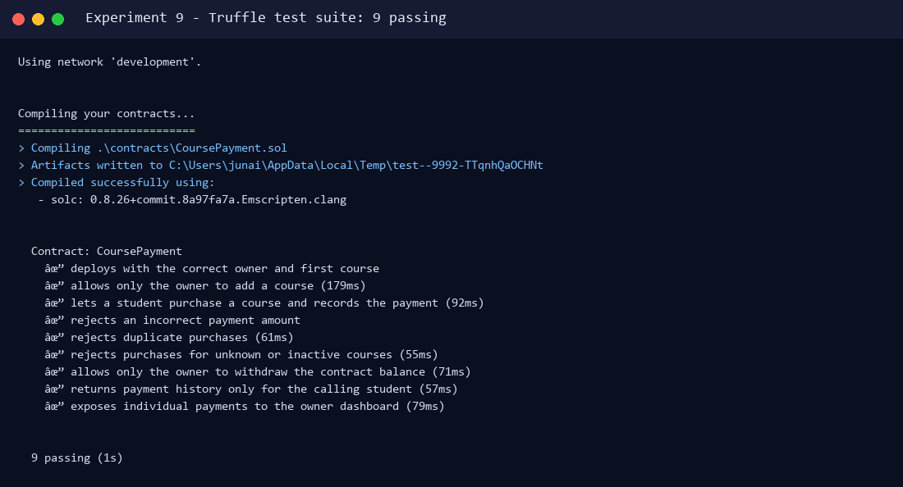
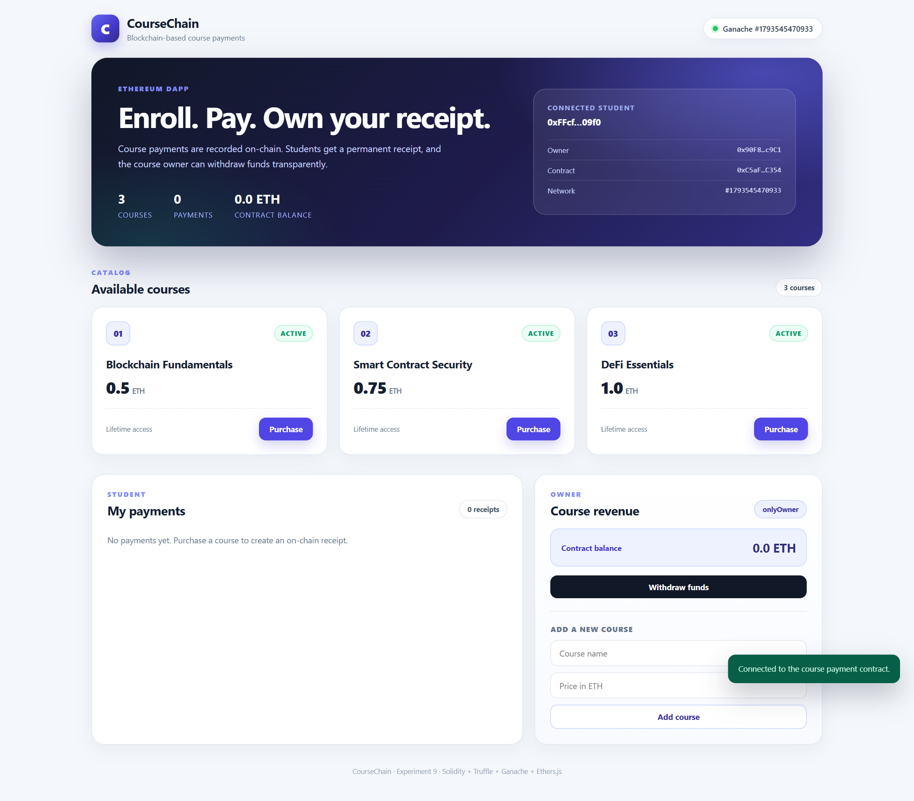
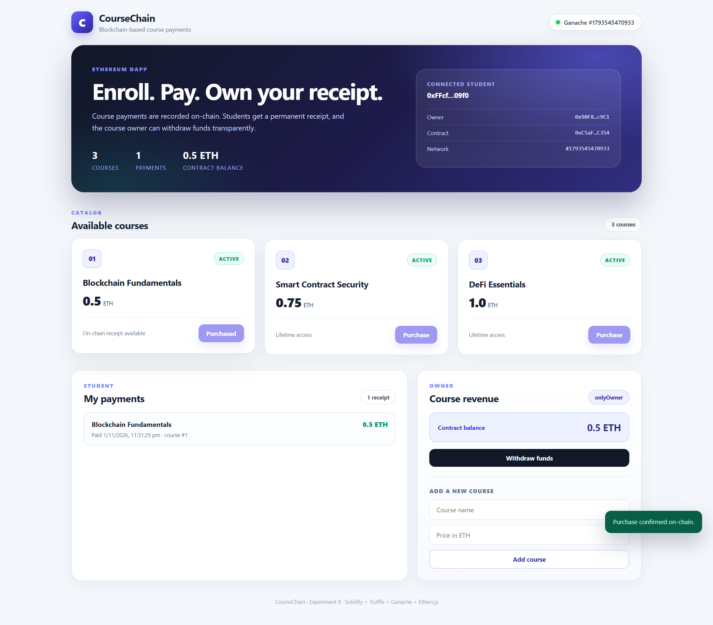
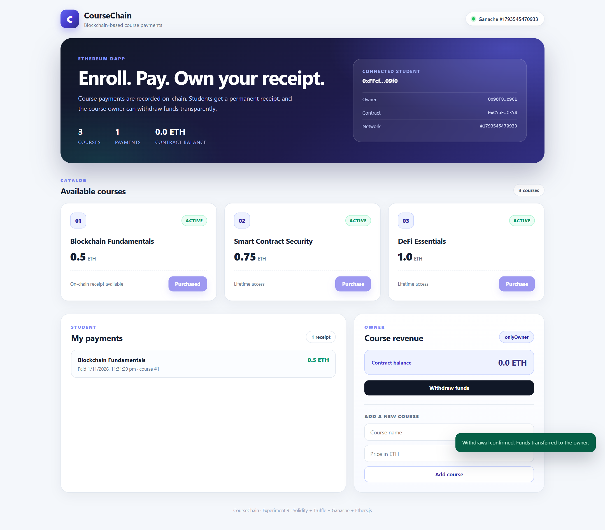

# Experiment 9 — Blockchain-Based Course Payment DApp

**Aim:** To design and develop a mini-project on a blockchain-based course payment DApp using Ethereum smart contracts.

**Lab Outcome:** LO 9 — Build, test and deploy a complete Ethereum DApp.

---

## 1. Abstract

This mini-project implements **CourseChain**, a decentralized course-payment application on Ethereum. Students pay for courses through a Solidity smart contract; every payment is recorded on-chain as an immutable receipt. The course owner can withdraw the collected funds, and students can query their own payment history. The DApp uses Truffle for development, Ganache as the local Ethereum network, and Ethers.js for the browser interface.

### 1.1 Problem

Traditional course-fee systems rely on a centralized database and a payment intermediary:

- A single server is a single point of failure.
- Payment records can be changed or lost by the operator.
- Students have no independent proof of payment.
- Refund and reconciliation disputes are hard to audit.

### 1.2 Objectives

- Let students purchase courses in a trustless way.
- Store each payment permanently on-chain.
- Allow the owner to withdraw collected funds.
- Give students a transparent, verifiable payment history.
- Enforce access control for owner-only operations.

### 1.3 Proposed solution

A Solidity contract stores courses, prices, purchase flags and payment records. The owner adds courses and withdraws revenue. Students call `purchaseCourse` with the exact course price. The contract emits events and exposes read functions for the UI.

---

## 2. Technology Stack

| Layer | Technology |
|---|---|
| Smart contract | Solidity 0.8.26 |
| Development framework | Truffle 5.11.5 |
| Local blockchain | Ganache 7.9.2 (port 7545, chain id 1337) |
| Contract compiler | solc 0.8.26, EVM target `shanghai` |
| Frontend | HTML, CSS, vanilla JavaScript |
| Blockchain library | Ethers.js 6 (bundled UMD build) |
| UI testing / screenshots | Playwright with Microsoft Edge |

---

## 3. Architecture

```text
Student (browser, account 1)                 Owner (browser, account 0)
            │                                             │
            ▼                                             ▼
      CourseChain UI  ────── Ethers.js ──────►  Ganache RPC (127.0.0.1:7545)
            │                                             │
            └──────────────► CoursePayment contract ◄─────┘
                                      │
                                      ▼
                         Ethereum state + event logs
```

- The UI reads the contract address and ABI from `ui/deployment.json`.
- Account 0 is the deployer/owner; account 1 is the student.
- All writes are real Ganache transactions; no mock data is used in the screenshots.

---

## 4. Smart Contract

Source: `contracts/CoursePayment.sol`.

### 4.1 Data model

```solidity
struct Course {
    string name;
    uint256 price;
    bool active;
}

struct Payment {
    address student;
    uint256 courseId;
    uint256 amount;
    uint256 timestamp;
}
```

State:

- `owner` — deployer address.
- `courseCount` — number of courses.
- `courses` — course id → course.
- `hasPurchased` — student → course id → purchased flag.
- `studentPayments` — per-student payment history.
- `allPayments` — global payment list for auditing.

### 4.2 Core purchase logic

```solidity
function purchaseCourse(uint256 courseId) external payable {
    require(courseId > 0 && courseId <= courseCount, "Unknown course");
    Course storage course = courses[courseId];
    require(course.active, "Course is not active");
    require(msg.value == course.price, "Incorrect payment amount");
    require(!hasPurchased[msg.sender][courseId], "Course already purchased");

    hasPurchased[msg.sender][courseId] = true;
    Payment memory payment = Payment(msg.sender, courseId, msg.value, block.timestamp);
    studentPayments[msg.sender].push(payment);
    allPayments.push(payment);
    paymentCount += 1;

    emit CoursePurchased(msg.sender, courseId, msg.value, block.timestamp);
}
```

### 4.3 Owner withdrawal

```solidity
function withdraw() external onlyOwner {
    uint256 balance = address(this).balance;
    require(balance > 0, "No funds to withdraw");

    (bool success, ) = payable(owner).call{value: balance}("");
    require(success, "Withdrawal failed");
    emit Withdrawn(owner, balance);
}
```

### 4.4 Access control and events

- `onlyOwner` protects `addCourse`, `setCourseActive` and `withdraw`.
- Events: `CourseAdded`, `CourseStatusChanged`, `CoursePurchased`, `Withdrawn`.
- `getMyPayments()` returns only the caller's receipts; `getPayment(index)` supports owner-side auditing.

---

## 5. Test Suite

Nine Truffle tests cover the contract:



```text
Contract: CoursePayment
  ✔ deploys with the correct owner and first course
  ✔ allows only the owner to add a course
  ✔ lets a student purchase a course and records the payment
  ✔ rejects an incorrect payment amount
  ✔ rejects duplicate purchases
  ✔ rejects purchases for unknown or inactive courses
  ✔ allows only the owner to withdraw the contract balance
  ✔ returns payment history only for the calling student
  ✔ exposes individual payments to the owner dashboard

9 passing
```

Run:

```bash
cd experiments/09-course-payment-dapp
npx truffle test --network development
```

---

## 6. Deployment

Ganache was running on `127.0.0.1:7545`. Deployment was performed with:

```bash
cd experiments/09-course-payment-dapp
npx truffle migrate --reset --network development
npx truffle exec scripts/export_deployment.js --network development
```

Actual deployment result:

```text
Network name:    'development'
Network id:      1793545470933
Contract address: 0xC5aFE31AE505594B190AC71EA689B58139d1C354
Transaction hash: 0xe742c6f592c66a7161d7131e9d9621fc96ad3703f3751e324fa45b3056391647
Block number:     94
Gas used:         984027
Deployer:         0x90F8bf6A479f320ead074411a4B0e7944Ea8c9C1
```

The migration creates three courses:

| Id | Course | Price |
|---|---|---|
| 1 | Blockchain Fundamentals | 0.5 ETH |
| 2 | Smart Contract Security | 0.75 ETH |
| 3 | DeFi Essentials | 1.0 ETH |

`scripts/export_deployment.js` writes the address and ABI to `ui/deployment.json`, which the browser reads. The address changes whenever the contract is redeployed, so re-run the export after each migration.

---

## 7. DApp Interface

### 7.1 Dashboard



The dashboard shows:

- Connected student and owner addresses.
- Network and contract address.
- Three active courses with prices.
- Student payment history (empty initially).
- Owner revenue panel with contract balance and withdrawal button.
- Owner form for adding a new course.

### 7.2 Course purchase



The student purchased **Blockchain Fundamentals** for **0.5 ETH**:

- The payment count changed from `0` to `1`.
- The contract balance changed from `0.0 ETH` to `0.5 ETH`.
- The first course is marked **Purchased** and its button is disabled.
- The student's payment history shows the course, amount and timestamp.
- The transaction was mined on Ganache and confirmed by the UI.

### 7.3 Owner withdrawal



The owner called `withdraw()`:

- The contract balance changed from `0.5 ETH` to `0.0 ETH`.
- The owner received the funds (minus gas).
- The student's on-chain receipt remains unchanged.

---

## 8. Running the DApp

### 8.1 Prerequisites

- Node.js and the root `node_modules` (Truffle, Ganache, Playwright, Ethers).
- Ganache on port 7545.

Start Ganache:

```bash
npx ganache --port 7545 --deterministic --chain.chainId 1337
```

### 8.2 Deploy and export

```bash
cd experiments/09-course-payment-dapp
npx truffle migrate --reset --network development
npx truffle exec scripts/export_deployment.js --network development
```

### 8.3 Serve the UI

From the repository root:

```bash
python -m http.server 8080 --bind 127.0.0.1
```

Open:

```text
http://127.0.0.1:8080/experiments/09-course-payment-dapp/ui/index.html
```

The UI uses account 0 as owner and account 1 as student. Both are unlocked Ganache accounts, so no MetaMask confirmation is required for this local demo. In a public deployment, the same contract can be connected to MetaMask by replacing the provider with `window.ethereum`.

### 8.4 Regenerate screenshots

```bash
node experiments/09-course-payment-dapp/scripts/screenshot_course_dapp.js
```

---

## 9. Security Considerations

- **Exact payment** — `msg.value == course.price` prevents underpayment and accidental overpayment.
- **Duplicate purchase guard** — `hasPurchased` prevents paying twice for the same course.
- **Access control** — `onlyOwner` protects course creation, activation and withdrawal.
- **Checks-effects-interactions** — the withdrawal sends the full balance and does not expose a re-entrant state update.
- **On-chain audit trail** — events and payment records are immutable.
- **Local demo only** — Ganache accounts and private keys are public test keys; never use them on mainnet.

Possible production improvements: refunds, course capacity limits, IPFS-hosted course content, signature-based enrollment, and a factory contract for multiple instructors.

---

## 10. Result

A complete Ethereum DApp was designed, implemented, tested and deployed. The Solidity contract passed all nine Truffle tests. A real student purchase of 0.5 ETH was recorded on Ganache, the UI displayed the on-chain receipt, and the owner successfully withdrew the contract balance. The screenshots were captured from the running DApp using Playwright and Microsoft Edge.

**Conclusion:** Thus, a blockchain-based course payment DApp using Ethereum smart contracts was successfully designed, developed, tested and deployed.

---

## 11. Project Files

```text
experiments/09-course-payment-dapp/
├── contracts/CoursePayment.sol
├── migrations/1_deploy_course_payment.js
├── test/course_payment.test.js
├── truffle-config.js
├── scripts/export_deployment.js
├── scripts/screenshot_course_dapp.js
├── ui/index.html
├── ui/styles.css
├── ui/app.js
├── ui/deployment.json
├── ui/vendor/ethers.umd.min.js
└── output/
    ├── 01_dapp_dashboard.png
    ├── 02_purchase_confirmed.png
    ├── 03_owner_withdraw.png
    ├── 04_tests_passing.png
    ├── migrate.log
    ├── export.log
    └── test.log
```
